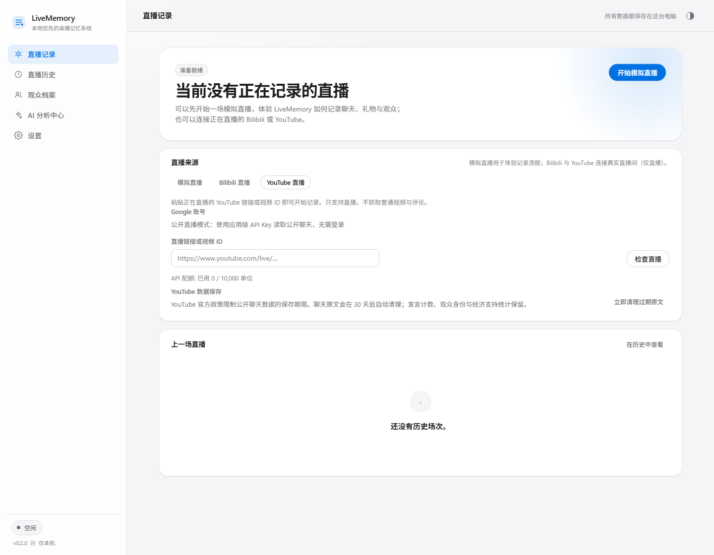
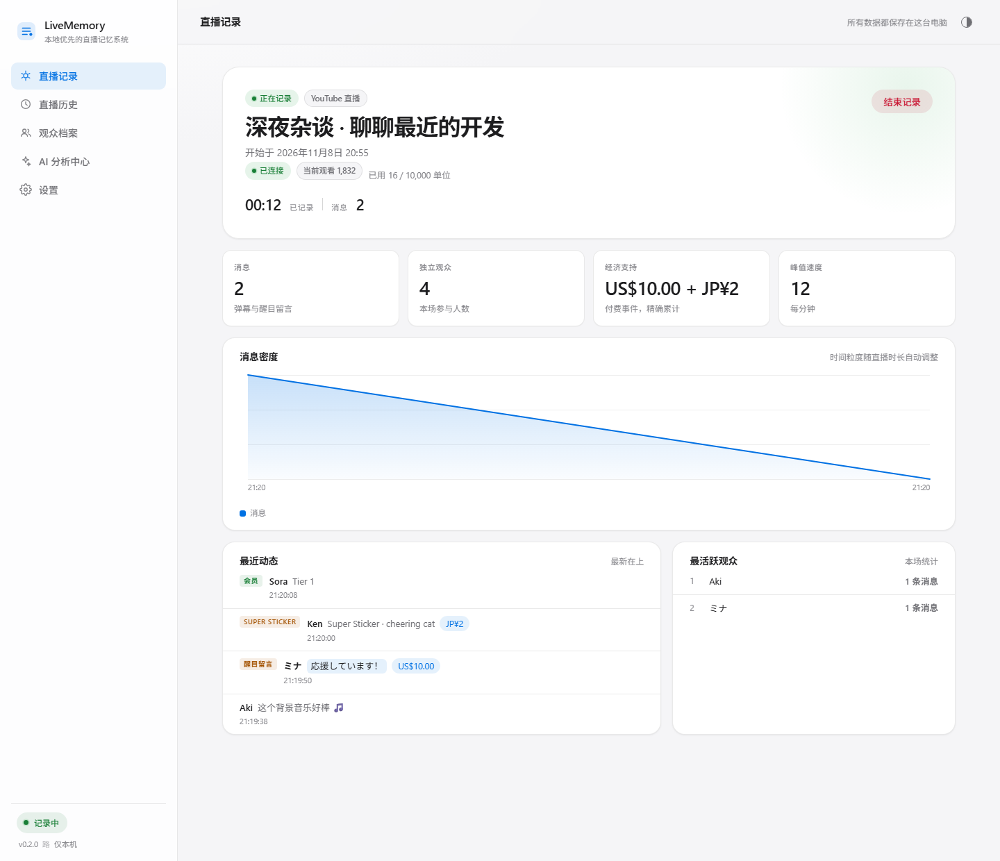

# LiveMemory 直播记忆

本地优先、不依赖 AI API 的直播记录与长期观众记忆系统，支持 **Bilibili Live** 与 **YouTube Live**（两者均已接入真实直播）。

Local-first livestream memory for Bilibili Live and YouTube Live. No cloud, no AI API keys, no account required.

---

## 简体中文

### 这是什么

LiveMemory 在你自己电脑上记录一场直播的聊天、礼物、醒目留言与大航海事件，按场次统计热度与收入，并为每一位观众建立以**平台稳定 ID** 为基础的长期档案。AI 分析通过「导出 AI 分析包 → 手动交给任意 AI 服务 → 导入结果」完成，软件本身不连接任何 AI 服务，也不绑定 AI 品牌。

### 现在能做什么（v0.2.0）

- 双击启动本地控制台，自动打开系统默认浏览器，数据保存在 `%LOCALAPPDATA%\LiveMemory\`
- 中文 / 日本語 / English 三语界面与命令行，默认跟随系统语言，可手动覆盖并持久保存
- 跟随系统 / 明亮 / 黑暗三种主题，独立设计，切换不闪烁、不丢失内容
- 模拟直播：完整验证「事件 → SQLite → 统计 → 时间线 → 事件流」记录链路
- 直播记录、直播历史（含单场详情与热度曲线）、观众档案、AI 分析中心、设置五个页面
- **Bilibili 直播**：真实 WebSocket 弹幕、礼物、醒目留言、大航海、平台表情；扫码登录可选
- **YouTube 直播**：粘贴正在直播的链接即可记录。公开直播模式使用应用级 API Key，主播无需登录、无需自己申请任何 Key；也可以点一次「登录 Google」使用 OAuth。支持 Super Chat、Super Sticker、会员与赠送会员、多币种分账，以及 30 天原文保留策略
- 一键导出 `livememory-analysis-v1` 分析包（含聊天 JSONL、统计、观众上下文、平台表情字典、三语 AI 分析指令与结果 Schema）
- 普通文字、Unicode Emoji 与平台表情正确保存；AI 包用文字名称/代码表达，不强制下载表情图片
- 单场直播的所有金额按币种和「实际支付 / 展示价值」分别精确累计，重复事件不会翻倍






### 尚未完成

AI 结果导入与校验、可迁移备份（`.livememory`）、AI 长期画像、正式发布版 EXE 的干净环境验收仍未完成。YouTube 的代码链路已完整实现并通过本地假 API 的端到端测试，但**真实 Google 凭据下的直播采样尚未完成**（详见 [docs/STATUS.md](docs/STATUS.md)）。请以 [docs/STATUS.md](docs/STATUS.md) 为准。

### YouTube 凭据说明

- **普通主播不需要**注册 Google Cloud、申请 API Key 或填写任何密钥。
- 只有发布者需要一次性配置：YouTube Data API 的 API Key（公开数据用）或 OAuth Desktop 客户端。
- 默认构建**不包含**任何凭据；缺少配置时界面会明确说明。配置方式见 [docs/PLATFORM_INTEGRATIONS.md](docs/PLATFORM_INTEGRATIONS.md) §3。
- YouTube 官方政策限制公开聊天数据保存不超过 30 天；LiveMemory 默认 30 天后自动清理聊天原文，保留统计与观众身份。

### 开发运行

需要 Node.js **22.5 或更高**（内置 SQLite）。项目运行时零依赖，无需 `npm install`。

```bat
start.cmd
:: 或者
node src/launcher/launcher.mjs
```

常用参数：

```text
--no-open            启动后不自动打开浏览器
--port <端口>        指定本地端口（默认 47800，占用时自动顺延）
--data-dir <路径>    指定用户数据目录
--lang <语言>        zh-CN | ja | en
--version / --help
```

运行测试：

```bat
node --test tests/unit tests/integration
```

> 在受限环境（禁止子进程）中可使用单进程模式：
> `node --test --test-isolation=none "tests/**/*.test.mjs"`

### 打包 Windows EXE

```bat
node scripts/build-windows.mjs
```

产物为 `dist/LiveMemory.exe`。使用 Node 官方运行时 + SEA 注入，内置 `node:sqlite`，无需在用户机器上编译原生模块。

### 数据与隐私

- 只监听 `127.0.0.1`，端口动态选择，不暴露公网
- 不写入注册表、不写 `Program Files`、不需要管理员权限
- 日志不记录 Cookie、Token、聊天正文；备份默认不包含任何登录凭据
- 关闭控制台窗口应使用 Ctrl+C，程序会刷新数据并关闭数据库

---

## 日本語

LiveMemory は、配信のチャット・ギフト・スーパーチャット・ギャラリーを**自分の PC 上**に記録し、視聴者ごとの長期プロフィールを作るローカル優先のツールです。AI 分析は「AI 分析パッケージ出力 → 任意の AI サービスに手動で渡す → 結果を取り込む」方式で、クラウドや API キーは使わず、特定の AI ブランドにも依存しません。

- 対応 UI / コンソール: 简体中文・日本語・English（システム言語に追従、手動変更は保存されます）
- テーマ: システムに従う / ライト / ダーク（個別設計・再起動後も維持）
- 対応: 起動・設定・模擬配信の記録・履歴・視聴者一覧・AI 分析パッケージ出力・Bilibili 実配信（チャット/絵文字）・YouTube 実配信（Super Chat / Super Sticker / メンバー / 多通貨）
- YouTube は公開配信モード（アプリ側 API キー、ログイン不要）または Google OAuth で接続します。配信者が自分で API キーを取得する必要はありません。既定のビルドには認証情報が含まれず、その場合は画面に明示されます
- チャット本文は YouTube のポリシーに合わせて既定 30 日で自動削除し、統計と視聴者の識別情報は保持します
- AI 結果の取り込み、ポータブルバックアップは今後実装予定

開発時は Node.js 22.5 以降が必要です（SQLite は実行環境に内蔵）。詳細は [docs/STATUS.md](docs/STATUS.md) と [docs/WINDOWS_RUNTIME.md](docs/WINDOWS_RUNTIME.md) を参照してください。

---

## English

LiveMemory records chat, gifts, Super Chats and membership events **on your own computer**, and builds long-term viewer profiles keyed by stable platform IDs. AI analysis is a manual round trip: export an AI analysis package, give it to any AI service you choose, import the result. No cloud service, no API key, no vendor account.

Current build (v0.2.0) delivers the Windows launcher, tri-language Apple-style console, theme system, persistent settings, a simulated recording pipeline backed by SQLite, real Bilibili chat with Unicode emoji and platform emotes, real YouTube Live chat (anonymous application key **or** one-click Google OAuth), Super Chat / Super Sticker / membership events with per-currency totals, a 30-day raw-chat retention policy, session history, viewer profiles and an analysis-package export. AI result import and portable backup are scheduled for later milestones — see [docs/STATUS.md](docs/STATUS.md).

Streamers never create their own API key or Google Cloud project: the published build either carries an application key for public data or offers one-click sign-in. A stock source checkout carries neither, and the UI says so explicitly. Real-credential live sampling was not possible in this development environment (see [docs/STATUS.md](docs/STATUS.md)).

```bat
start.cmd            :: development
node scripts/build-windows.mjs   :: LiveMemory.exe
```

Node.js 22.5+ is required for development runs. There are no runtime dependencies.

---

## 文档 / Documents

| 文档 | 内容 |
| --- | --- |
| [AGENTS.md](AGENTS.md) | 开发规则：每轮必读、命令、提交约定 |
| [docs/PRODUCT.md](docs/PRODUCT.md) | 产品定位与验收标准 |
| [docs/STATUS.md](docs/STATUS.md) | 真实工程状态（唯一进度来源） |
| [docs/HANDOFF.md](docs/HANDOFF.md) | 跨对话交接 |
| [docs/ROADMAP.md](docs/ROADMAP.md) | M0–M8 里程碑 |
| [docs/ARCHITECTURE.md](docs/ARCHITECTURE.md) | 模块边界与数据流 |
| [docs/DATA_MODEL.md](docs/DATA_MODEL.md) | 数据库、身份、金额、生命周期 |
| [docs/AI_CONTRACT.md](docs/AI_CONTRACT.md) | 分析包与结果 Schema 协议 |
| [docs/PLATFORM_INTEGRATIONS.md](docs/PLATFORM_INTEGRATIONS.md) | 平台接入现状与限制 |
| [docs/BACKUP_RESTORE.md](docs/BACKUP_RESTORE.md) | 备份格式与恢复流程 |
| [docs/WINDOWS_RUNTIME.md](docs/WINDOWS_RUNTIME.md) | EXE、启动器、权限、单实例 |
| [docs/UI_DESIGN.md](docs/UI_DESIGN.md) | 视觉规范、主题、响应式、多语言 |
| [docs/PRIVACY_SECURITY.md](docs/PRIVACY_SECURITY.md) | 本地监听、凭据、导入安全 |
| [docs/TEST_PLAN.md](docs/TEST_PLAN.md) | 测试策略与验收记录 |
| [docs/DECISIONS.md](docs/DECISIONS.md) | ADR |
| [docs/RELEASE.md](docs/RELEASE.md) | 打包与发布流程 |
| [docs/CHANGELOG.md](docs/CHANGELOG.md) | 版本变化 |

## License

MIT © 2026 zgrg29
