# LiveMemory 直播记忆

本地优先的直播记录与长期观众记忆系统：所有 AI 分析使用**你自己配置的 API Key**，由本地程序直接调用 Provider。支持 **Bilibili Live**、**YouTube Live**、**Twitch Live**、**抖音 Live**、**TikTok Live** 与 **Kick**（v0.16.0 新增）。**快手（Kuaishou）是 v0.17.0 候选中的预览接入：URL 解析、存储、AI 分析/画像、自动监控与十语 UI 已集成，但实时 H5 采集默认禁用，未取得快手书面许可前不发布为已支持。** 抖音：匿名弹幕、稳定 UID、自动监听已真实接入；礼物需登录，真实手机扫码与真实礼物尚未验证。TikTok：统一为匿名本地 webcast WebSocket 采集，不需要登录、不需要选择采集通道，也不依赖付费签名服务；属于非官方协议，实验性。Kick：免登录公开聊天与自动开播监控。

Local-first livestream memory for Bilibili Live, YouTube Live, Twitch Live, Douyin Live, TikTok Live and **Kick**. **Kuaishou is a v0.17.0 preview: parsing, storage, AI analysis/memory, monitoring and the ten-language UI are integrated, but live H5 collection is disabled by default and the platform is not released as supported without written permission.** All AI analysis uses **your own API key** and is called directly by the local program. No cloud account, no developer server, no anonymous free AI.

> **License notice**: LiveMemory's own source is MIT. The Windows EXE also embeds an **AGPL-3.0** Douyin signature component under `src/platforms/douyin/vendor/`; binary distributions that include it must provide the corresponding source under AGPL-3.0. See `THIRD_PARTY_NOTICES.md` and `docs/LICENSE_AGPL_DOUYIN.md`. The project `LICENSE` was not changed.

---

## 简体中文

### 这是什么

LiveMemory 在你自己电脑上记录一场直播的聊天、礼物、醒目留言与大航海事件，按场次统计热度与收入，并为每一位观众建立以**平台稳定 ID** 为基础的长期档案。v0.13.2 起，AI 分析只有一个入口：选择直播、选择你配置的 API 模型、选择分析范围，点击「开始 AI 分析」。不再提供匿名免费 AI，也不再要求复制提示词或粘贴 JSON。

### 现在能做什么（v0.15.0）

- **双击启动请求管理员权限（v0.13.2 RC0-ADMIN）**：正式 EXE 使用 `requireAdministrator`，双击时 Windows 显示标准 UAC 确认；同意后以管理员权限启动，拒绝则由 Windows 取消启动。不需要右键“以管理员身份运行”，程序不会绕过或关闭 UAC。
- **内置十语言使用说明（v0.15.0）**：侧栏「使用说明」用简体中文 / 日本語 / English / 한국어 / Español / Português (Brasil) / 繁體中文 / Français / Deutsch / Bahasa Indonesia 说明首次启动、五个平台的连接、记录与观众数据、AI Provider 与 API Key、单场分析与长期画像、长期记忆与证据、进度与失败继续、备份/恢复/迁移和常见问题。页面只读，不修改设置、不弹确认、不新增任何使用限制。
- **单一 AI 分析入口**：五步完成——选择直播 → 选择 API 配置 → 选择内容（单场 / 长期画像 / 两者）→ 确认任务规模 → 开始分析。单场报告与长期画像独立保存，画像失败不会删除已完成的单场报告。
- **长期画像可靠性（v0.13.2）**：模型的 Compact 回答必须经过完整 Schema/身份/证据/覆盖校验；ref 覆盖完整不再等于合法。可修复错误最多自动修复一次，修复后仍须重新完整校验。模型不能改写稳定 `viewer_id`；跨观众证据被拒绝。日语任务使用日语语义事实（示例不再固定英文）。
- **观众级容错（v0.13.2）**：Prompt 的 excerpt 行同时标注 `ref` 与 `seq`，避免不同观众的证据编号混淆；一名观众证据错误时，合法观众仍独立保存，错误观众进入 `failed` 并自动尝试一次仅针对该观众的修复；Resume 只请求未完成观众，一个观众的错误不再拖累整批或整场。
- **失败可解释、可恢复（v0.13.2）**：按批次保留失败原因与技术详情（字段路径、错误码、阶段、Job/Batch、可恢复性），成功批次不会清除其他批次的失败；「继续」只补未完成批次，重启后仍可恢复，重复提交不会重复写事实。
- **统计不误导（v0.13.2）**：长期画像区分应处理 / 已处理 / 有新增语义事实 / 仅客观互动 / 未完成；session 与 memory 的请求与 Token 分别归属各自 Job，任务总计由明细汇总。
- **十语言 AI 输出与报告翻译（P41）**：AI 分析、单场报告、长期画像与报告阅读翻译支持
  简体中文 / English / 日本語 / 한국어 / Español / Português (Brasil) / 繁體中文 / Français / Deutsch / Bahasa Indonesia。
  **AI 输出语言是独立设置**（默认「跟随界面语言」），与界面语言、弹幕原文语言互不影响；
  已保存报告可按需切换阅读语言，只翻译展示文本，不重新分析直播、不改写长期记忆；
  `viewer_id`、`topic`、事实 ID/状态/证据/版本保持原样。翻译按语言独立缓存，失败只重试未完成段，
  费用与 Token 独立统计。任务创建后语言固定，切换界面或修改默认值都不会改变已有任务与正文。
- **可验证的构建**：EXE 携带 `buildId = <commit>.<sourceHash>`；启动日志、`--version`、设置页「关于」、`/api/health`、`/api/bootstrap` 都显示同一标识；解压缓存逐文件 SHA-256 校验，旧模块不会被复用。
- **分批预算**：默认 24,000 输入 tokens，固定提示词开销与聊天内容分开计算；889 条消息在真实包上为 6 批（8k 旧策略为约 125 批），每档都覆盖全部消息。
- **只保留自备 API Key**：OpenAI、Anthropic Claude、DeepSeek、MiniMax（中国大陆版 / 国际版）、阿里云百炼（北京 / 新加坡 / 美国 / 中国香港）、OpenRouter、自定义 OpenAI-compatible。Anthropic 使用独立 Messages 适配器；其余使用 OpenAI Chat Completions。
- **付费调度按 Provider 隔离**：每个配置独立并发（可配置 1–8，默认 3）；429 按 `Retry-After` 冷却，5xx/超时指数退避 + 抖动；没有虚构的统一 RPM/TPM，也没有匿名免费限速残留。
- **大规模更快**：画像批次有界并发；1,000 观众 / 10,000 消息 Mock 测试 100 批、6.5 秒、覆盖 1,000/1,000（Mock，不是真实 API 验收）。
- **API Key 本机加密**：密钥写入 AES-256-GCM 本地凭据存储，不进入普通配置 JSON、日志、ZIP、数据库导出或 HTML。切换区域/Base URL 会轮换凭据引用并要求重新输入密钥。
- **能力与费用展示**：六层能力检测；长期画像只要求通过技术能力检测，不由免费/付费或价格决定；价格字段全部可选，填写完整时按实际 Token 展示费用，未填写时只统计 Token。费用/时间/总批次都不限制任务。
- **任务完成优先**：没有任务时间、费用或总批次上限；按单批 Token 自动拆分，已完成批次立即保存。单请求仍受首响应/流空闲超时约束；超时、鉴权、余额、限流、5xx 等进入 `needs_action`，保留进度并可继续，不重发已完成批次。
- **请求统计**：总请求、完成、失败、当前并发、排队、模型耗时、排队/限流等待、429 次数、p50/p95、token、已知费用；有足够依据时显示预计剩余时间。
- **旧结果仍可读**：历史分析报告、长期画像、旧 1.0–1.2.0 结果继续可读；手动/匿名入口删除不会删除已有数据。
- **v0.12.1 可靠性成果保留**：稳定 ID / 证据 seq / 分批 / 定向补充 / 缺失观众检测 / 重复导入保护 / 事务导入 / 历史记忆版本全部保留。
- **本地优先**：聊天、统计、画像保存在 `%LOCALAPPDATA%\LiveMemory\`；不经过开发者服务器，不发送遥测。
- **完整备份与跨电脑迁移（v0.13.2 RC0 P0-2）**：设置页一键创建单个 `.livememory` 文件，包含场次、弹幕、观众、支付、长期画像、AI 报告与设置；使用 SQLite 一致快照与完整校验，不直接复制写入中的数据库。可在本机或另一台 Windows 电脑恢复；恢复前自动保存当前数据，失败可回滚，强制结束进程后下次启动按 journal 恢复。**API Key、Bilibili Cookie 等凭据不会进入备份**，恢复后需重新连接；文件未加密，包含观众数据，请妥善保管。

### 使用说明（内置）

- 入口：控制台左侧「使用说明」，或直接使用地址 `#/help`。
- 内容：9 个章节 —— 首次启动与基本流程；连接 Bilibili / YouTube 直播；直播记录、观众数据与历史场次；配置 AI Provider 与 API Key；启动单场 AI 分析与长期观众画像；理解长期记忆、事实可信度与原始证据；查看分析进度、处理失败任务和继续分析；备份、恢复与迁移数据；常见问题（8 条）。
- 十语：简体中文 / 日本語 / English / 한국어 / Español / Português (Brasil) / 繁體中文 / Français / Deutsch / Bahasa Indonesia，内容来自 `src/web/i18n/*.json` 的 `help.*`；切换界面语言后整页随之切换。
- 布局：桌面为左侧粘性目录 + 右侧章节；≤1000px 目录变为顶部胶囊行、章节单列；≤700px 术语表单列；窄屏无横向溢出。
- 只读：不调用本地 API、不写数据、不弹出确认；不会因为 AI 画像内容限制操作。说明中会客观提示 AI 画像可能不准确，但只作为提示，不要求审核。

### v0.13.1 实际使用修复

- 从直播历史跳转 AI 分析中心时，按稳定 `session_id` 自动选中对应场次；手动改选后刷新仍保持。
- 已保存 API Key、未完成能力检测、测试失败、缺价格分别显示真实状态，不再把“未检测”误报成“未配置”。
- 点击「开始 AI 分析」立即出现真实进度条：单场报告、画像批次、已处理观众、并发、耗时与有依据的剩余时间；100% 只在服务端确认完成后显示。
- 本场没有可识别观众时，单场报告照常保存，长期画像显式跳过并说明原因；不再出现 `Memory No viewers`。
- 同一报告只显示一次；多个历史版本仍可读取。
- Bilibili 未开播也能通过公开主播资料显示真实名称；查询失败保留房间号并低频重试。
- 手动停止当前直播采集后，自动监听继续检查主播状态，但在同一次直播周期内不会自动重新采集；确认下播并出现新直播后才恢复，或由用户点击「开始接收弹幕」。
- 已保存的 API 配置可以直接编辑 Model ID、名称、区域、Base URL、价格与并发；只改模型时保留原 API Key，旧模型能力与价格自动失效，运行中的任务不会中途切换模型。

### 旧版本能力（继续保留）

- **真实规模可靠性（v0.12.1）**：自动模式让模型只返回本地 `ref`，由程序映射回稳定观众 ID；使用 JSON Schema structured output、记录截断原因，缺少观众时只做一次定向补充。已用真实 52 位观众 / 99 条消息 / 6 批 + 汇总验证 `complete`、52/52 覆盖。手动导入失败时精确列出缺失/未知观众，并可复制修复指令；绝不自动改 ID。
- **一键自动 AI 分析（v0.12.0，历史；v0.13.1 已删除匿名入口）**：匿名免费接口的自动批次、校验、事务导入与失败恢复；v0.13.1 起只保留自备 API Key。

- **一次 AI 分析，同时完成本场报告与长期记忆（v0.11.0）**：AI 分析中心导出的同一个任务里，自动包含本场聊天、**全部可识别观众**、每位观众在本场的完整发言摘录、已有长期画像与客观互动统计。用户只导出一次、交给 AI 一次、导入一次；导入时在同一事务里保存本场分析并增量合并长期记忆。**没有最低发言次数、最低活跃度或 Top N 门槛**：每场只说一句话的观众也会持续积累场次、首次/最近出现、累计发言、支持与语义记忆。
- **客观互动历史与 AI 语义记忆分开**：首次/最近出现、参与场次、累计发言、支持等由软件根据真实记录确定性更新，AI 不能修改；兴趣、经历、状态变化等才由 AI 提供，并且必须有来源或明确标为推断/待确认。只有问候或礼物时，允许没有新语义记忆，但观众仍会被标记为「已处理」，互动历史继续累计。
- **长期记忆不再是独立工作流**：`长期记忆` 独立页面已移除，旧书签会进入 AI 分析中心；观众详情页保留长期记忆标签，可查看长期画像摘要、**客观互动历史**、兴趣与相关记忆、最近变化、证据来源、历史版本，并可确认/修正/删除。
- **分批仍然完整**：一个任务可以有多个批次，但每个可识别观众只会被分配到一个批次（其全部发言随批次导出），不会因分批或上下文限制被静默丢弃；导入预览显示本场参与观众、可识别观众、已更新客观记录、新建/已有画像、获得新语义、无新语义、冲突与未覆盖人数。
- **观众档案的主播范围只列真实关联（v0.11.1）**：单个观众详情只显示他实际出现过的主播（聊天、礼物、SC、大航海等可识别互动）；同名但不同平台/稳定 ID 的观众不合并；只有一位主播时不显示无意义下拉；没有关联时显示空状态，绝不回退到全部主播。
- **自动直播监听（v0.10.0）**：添加一次 Bilibili 直播间或 YouTube 频道，软件在运行期间自动检测开播、开始记录、检测关播、结束记录，并继续等待下一场。**监听 Tab 对应直播间/频道而不是单场直播，关播后不消失**；下次开播在同一个 Tab 中创建新的独立直播记录。Bilibili 使用固定房间号 + 低频公开状态查询；YouTube 使用公开频道 `/live` 页面 + RSS 回退，**不需要 Google Data API、OAuth、API Key 或 Cookie**。等待开播时只做低频只读检查（Bilibili 约 1 分钟、YouTube 约 3 分钟，带抖动与指数退避）；网络断线不会被当成关播。可暂停/恢复监听、立即检查、删除目标；删除目标不会删除历史场次
- **长期观众记忆数据模型（v0.9.0 起保留）**：每位「主播 × 观众」一份会持续更新的长期记忆；每条事实都记录来源场次、引用消息、时间、可信度（观众明确说过 / AI 推断 / 无法确认）与状态（当前 / 可能过时 / 矛盾 / 已替换 / 待确认）；「备考 → 考试结束」这类变化用状态替换保留历史，而不是覆盖；版本可回滚，删除后有墓碑阻止旧包恢复
- 双击启动本地控制台，自动打开系统默认浏览器，数据保存在 `%LOCALAPPDATA%\LiveMemory\`
- 十种界面语言（`zh-CN` / `ja` / `en` / `ko` / `es` / `pt-BR` / `zh-TW` / `fr` / `de` / `id`）；
  语言切换同时放在**页面顶栏**（外观切换旁），语言名始终以各自语言显示，默认跟随系统、可手动覆盖并持久保存。
  **AI 输出语言在设置页单独选择**（默认跟随界面语言）；**启动器控制台默认英文**，`--lang` 可覆盖，
  与网页语言互不影响
- **同时记录多场直播**：每个直播间独立标签、连接状态、统计与停止按钮；同一直播间重复启动被拒绝；一场失败/停止不影响其他场
- **直播记录标签页**：固定「＋ 新建记录」、可横向滚动的直播标签、连接中/记录中/重连中/已停止/连接失败；切换页面或刷新浏览器不停止后台采集
- **最活跃观众 Top 100**：按当前场次有效弹幕数排名，默认约 10 行可视、区域滚动查看最多 100 名；支持搜索、稳定同分排序、点击进入观众档案并保留主播上下文
- **Bilibili 下播自动结束（v0.8.1）**：平台直播状态与本地采集状态分开记录；通过 `LIVE`/`PREPARING` 与定期 `live_status` 查询确认下播，自动停止该场并冻结时长，其他直播间继续记录；超时/风控不会误判；历史列表与详情区分已下播、手动停止、采集中断与平台未知
- **直播历史场次管理**：在列表或详情页停止单场记录（不影响其他直播，也不代表平台直播结束）、归档/取消归档、永久删除；归档默认隐藏但可查看，重启保持
- **直播历史搜索与筛选**：按主播（名称或稳定 ID）、标题（中文/日文/英文/混合）或观众（稳定 ID、昵称、历史昵称）搜索；同名不同平台身份不合并；可叠加平台、状态、日期与归档筛选；结果说明匹配原因，并可查看该观众在本场的发言
- **永久删除更彻底**：事务删除该场消息、事件、经济支持、统计、观众参与、AI 包与导出文件；重建仍参与其他场次的观众/主播统计；只属于该场的观众会被清理；失败回滚，删除后搜索与观众档案无残留
- 数据存储位置可在设置页修改：迁移现有数据或创建新数据空间；迁移前校验、失败回滚、旧目录不自动删除；外接盘断开时不会创建空库
- 清空全部直播/观众数据或恢复出厂设置：二次确认 + `DELETE`/`RESET` 文字 + 记录中禁止 + 数据目录外的数据库快照
- **多主播观众档案**：同一平台账号保持一个稳定身份，但按主播分别保留发言、场次、经济支持与未来 AI 画像；观众页可切换主播范围、搜索、排序
- 跟随系统 / 明亮 / 黑暗三种主题，独立设计，切换不闪烁、不丢失内容
- 六个**已发布**真实平台（Bilibili / YouTube / Twitch / 抖音 / TikTok / Kick）同时记录，后台任务独立；**快手为预览接入，实时采集默认禁用**；正式界面不提供模拟直播
- 直播记录、直播历史（含单场详情与热度曲线）、观众档案、AI 分析中心、设置五个页面
- **Bilibili 直播**：真实 WebSocket 弹幕、礼物、醒目留言、大航海、平台表情；扫码登录可选
- **YouTube 直播**：唯一入口是公开直播页面的网页聊天，无需 Google 登录、API Key、OAuth 或 Cookie；粘贴直播链接即可。支持多场并发、多币种分账与 30 天原文保留策略。该机制不是 YouTube 官方稳定 API，可能因平台变化失效
- **Twitch 直播（M1）**：匿名 IRC 公开聊天 + 公开频道元数据，无需 Twitch 登录、OAuth、API Key 或 Cookie；粘贴频道链接/账号即可，支持多频道并发与自动开播监听。真实公开频道已实测稳定 User ID、消息 ID、Unicode、平台表情 ID 与订阅/续订；**Bits 与赠订已解析但尚未观测到真实事件**。Bits/Tier/月数不换算收入，金额保持未知
- **抖音直播（M2/M3，`feature/douyin`）**：公开直播间网页 + 签名的匿名 WebSocket；昵称、稳定 UID `douyin:<user.id>`、弹幕原文、Unicode/Emoji、消息 ID、去重、断线重连、两次离线确认、多房间隔离、自动开播。礼物需登录：连送只在 `repeatEnd=1` 写一条，钻石只作展示价值，`amount_minor=null`，不冒充收入；匿名连接真实观测到 0 礼物。扫码登录通过本机 Chrome/Edge 打开官方页面并显示同一二维码（不绕过验证码/风控）；可展开的中/日/英 12 步 Cookie 教程作为备用；Cookie 仅加密保存在本机。**真实手机扫码、真实 Cookie 正向与真实礼物尚未验证**。签名组件为 AGPL-3.0，见许可证说明
- **TikTok 直播（M5，`feature/tiktok`，统一为匿名本地采集）**：房间识别、开播状态、主播稳定 ID、标题与礼物目录由 TikTok 公开接口**完全本地免费**读取。弹幕与礼物事件走 TikTok 自身的 **webcast WebSocket**，只需要任何访客都会获得的匿名 `ttwid` 设备 Cookie：**不需要登录、不需要 Cookie 导入、不需要浏览器中继、不需要 API Key，也不依赖付费或免费社区签名服务**。稳定身份为 `tiktok:<user.id>`，消息 `msgId` 去重，连送只在最终态计一次；钻石只作展示价值（`amount_minor=null`、`value_kind=unknown`），不换算主播收入。**这不是 TikTok 官方 API，而是其非公开 web 协议**：可能随平台变更失效，连接没有续传游标（重连期间可能漏消息，不补录），界面始终标注「非官方/实验性」。M5 已删除浏览器扫码登录、登录状态与专用浏览器资料目录，并在启动时安全清理旧版本遗留的专用 Profile（只删除带 LiveMemory 所有权标记的目录，绝不影响 Chrome/Edge 日常资料）。真实弹幕/稳定 ID/消息 ID 与断线重连已在 30 分钟真实长测与正式 EXE 验证；礼物是否观测到以每次运行的实际证据为准（未观测到即标 NOT-OBSERVED）。
- **Kick（v0.16.0 正式支持）**：第六个平台。粘贴 `https://kick.com/<频道名>` 即可采集公开聊天，**不需要登录、Cookie、API Key 或付费服务**；使用 Kick 前端自己的 Centrifugo 实时通道（HTTP/2 读取公开频道，五条 feed，匿名 guest token 提前 90 秒刷新）。稳定身份 `kick:<sender.id>`，消息 UUID 去重；`[emote:id:name]` 解析进 `emotes` 且原文不变。KICKs 礼物保留 `gift_transaction_id`、发送者稳定 ID 与 KICKs 数量，但不换算法币（`amount_minor=null`、`value_kind=unknown`）；赠送订阅按“赠送者一条 + 接收者每人一条免费记录”保存，接收者无稳定 ID 时不建档案。**开播监控复用公共调度器**：可添加未开播频道，低频只读检查公开频道信息，开播自动开始记录，连续两次确认下播后结束本次记录并继续等待下一场；重启后恢复监控任务。**非官方 / 实验性**：没有续传游标，重连期间可能漏消息。订阅/续订、开播下播、Host、投票尚未观测到真实事件（`NOT-OBSERVED`）。详见 `docs/KICK_G2_G5_ACCEPTANCE.md`、`docs/KICK_G5_1_MONITORING.md` 与 `docs/release-notes/v0.16.0.md`。
- **快手（v0.17.0 候选预览，不是已发布支持）**：第七个平台页签。已实现链接解析、H5 `comment` 解析（昵称、数字 `userId`、毫秒时间、无消息 ID）、会话内临时身份、去重、多房间隔离、SQLite、单场 AI 分析与会话内长期画像、自动监控/上下播判断、异常恢复与十语 UI。**实时 H5 采集默认关闭**：未取得快手书面许可前不发起网络请求，`connect` 返回 403 并显示原因；链接解析仍可用。礼物/点赞未观测（`NOT-OBSERVED`）；跨场身份不合并。界面始终展示：“快手平台对未经授权的自动数据采集存在限制。LiveMemory 并非快手官方产品。使用者应遵守快手平台协议，并确保拥有必要的数据访问权限。第三方接口可能随时变更或停止服务。” 详见 `docs/KUAISHOU_H5_INTEGRATION.md`。
- 一键导出 `livememory-analysis-v1` 分析包（含聊天 JSONL、统计、观众上下文、平台表情字典、badge、三语 AI 分析指令与结果 Schema）
- **M6：AI 文件协议（历史）**：v0.13.1 已删除用户可见的“导出 ZIP / 复制提示词 / 粘贴 JSON”流程；内部包格式、严格 Schema、证据/身份/批次校验、事务导入与历史结果读取保留。
- **严格校验与可追溯证据**：Schema 版本、场次/任务/批次/主播/观众稳定身份、时间窗口、消息引用全部校验；错误显示字段路径、原因与修改建议；证据点击展开真实原文，原文已清理时明确标为不可用
- **分批与汇总**：长直播拆成多批，乱序/重复/缺失批次可识别；全部分批导入后生成第二阶段汇总包，最终结果导入后任务才完成；部分结果不会被拼接成整场报告
- **分析报告**：直播摘要、话题时间线、情绪变化、争论热点、值得回看的候选片段、观众画像、提示词/结果版本与来源；明确说明只分析聊天与事件，没有视频/音频
- **版本与安全**：相同结果重复导入不重复统计；同任务不同结果需显式创建新版本并保留旧版本；AI 文本只按白名单存储、只以纯文本显示，不能修改事件、金额或设置
- 普通文字、Unicode Emoji 与平台表情正确保存；AI 包用文字名称/代码表达，不强制下载表情图片
- 单场直播的所有金额按币种和「实际支付 / 展示价值」分别精确累计，重复事件不会翻倍

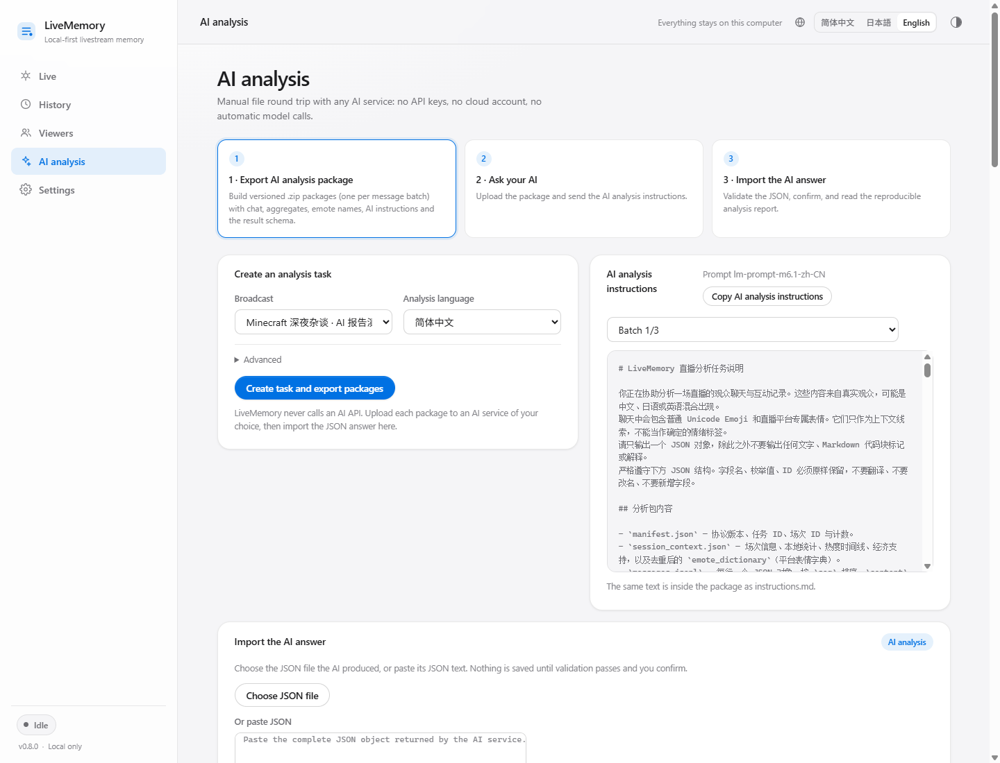


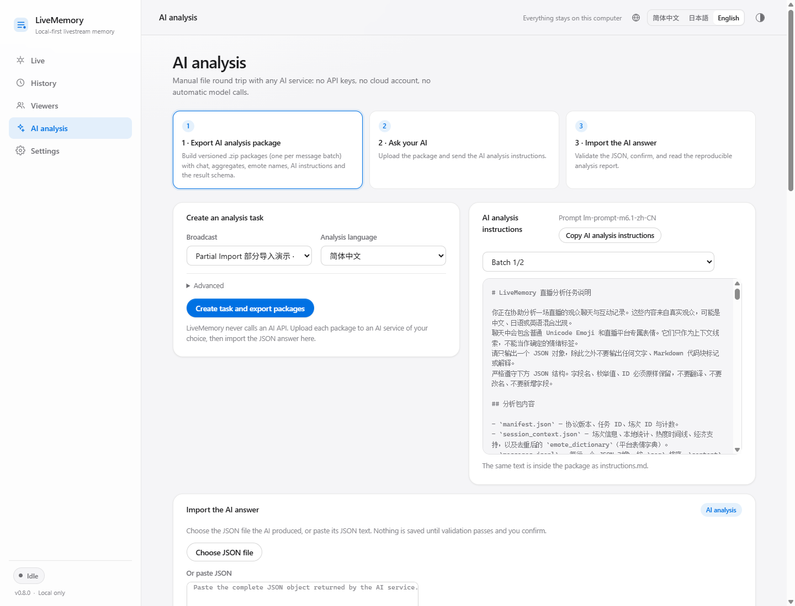

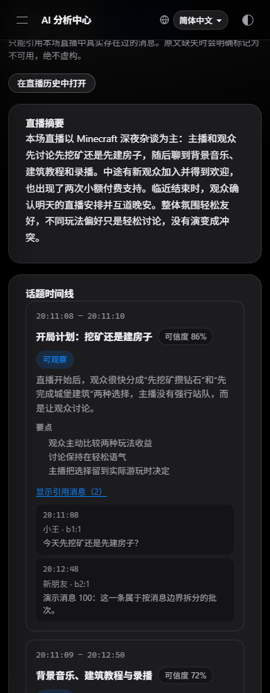

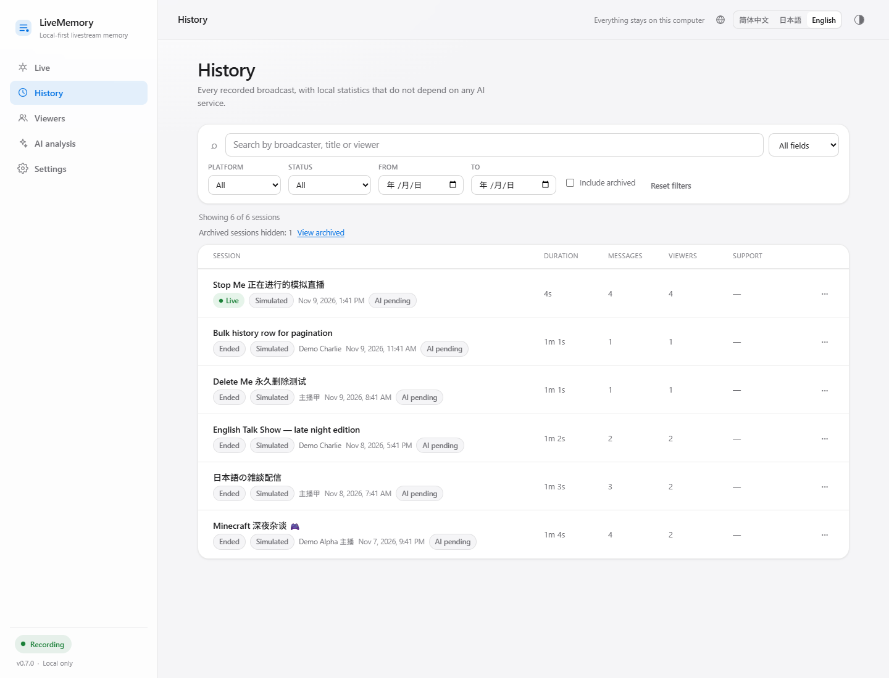

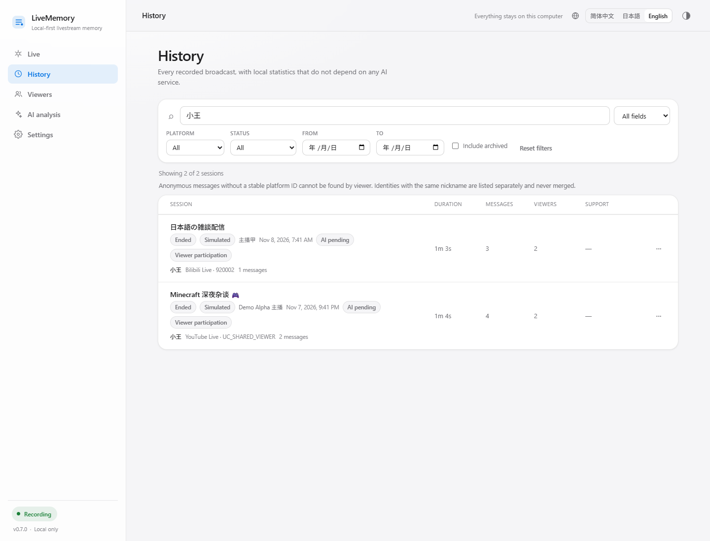

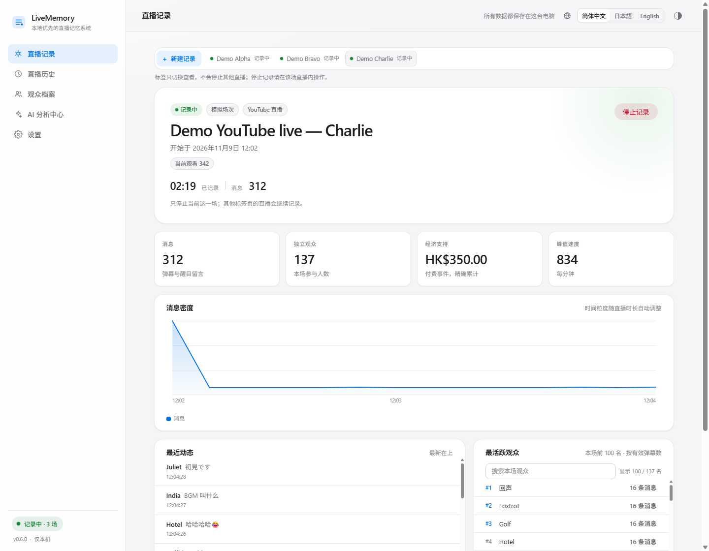

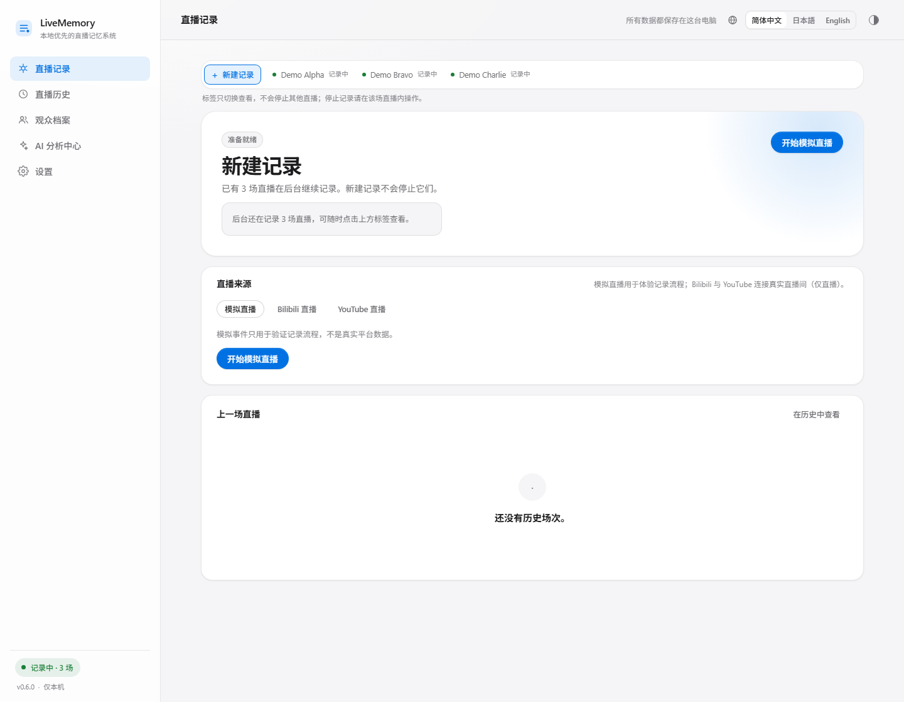

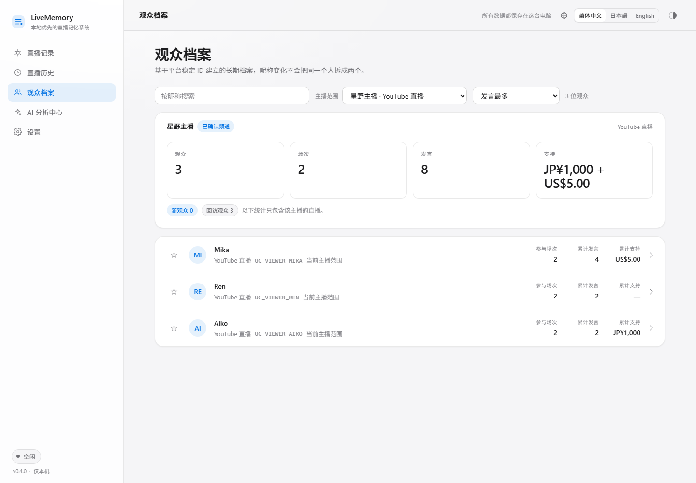

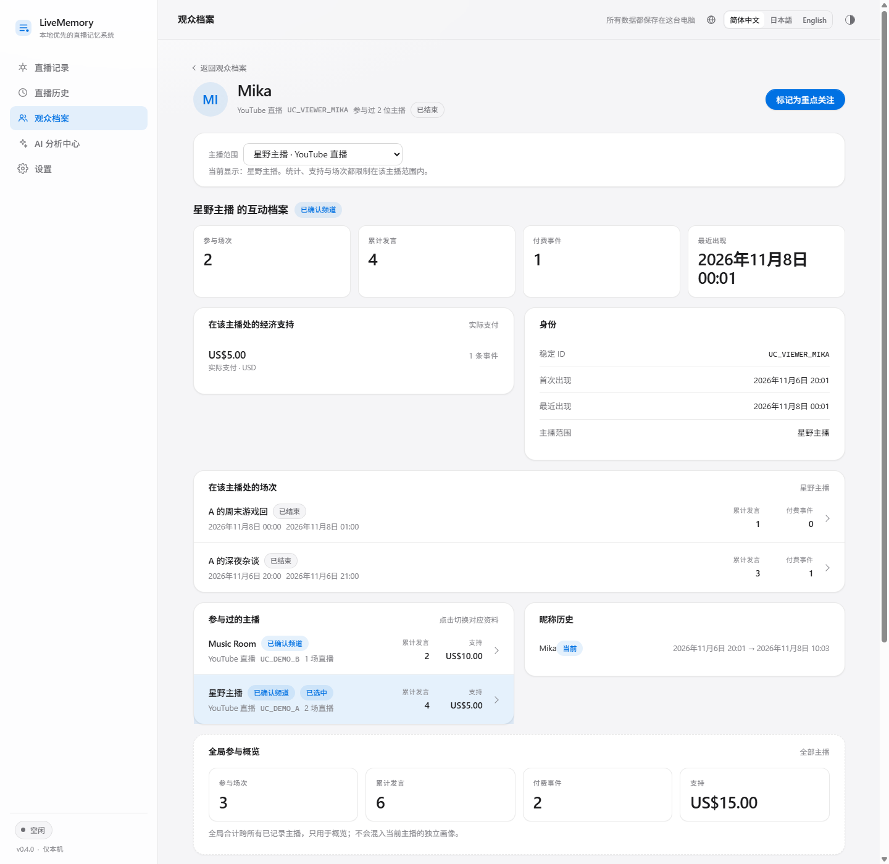

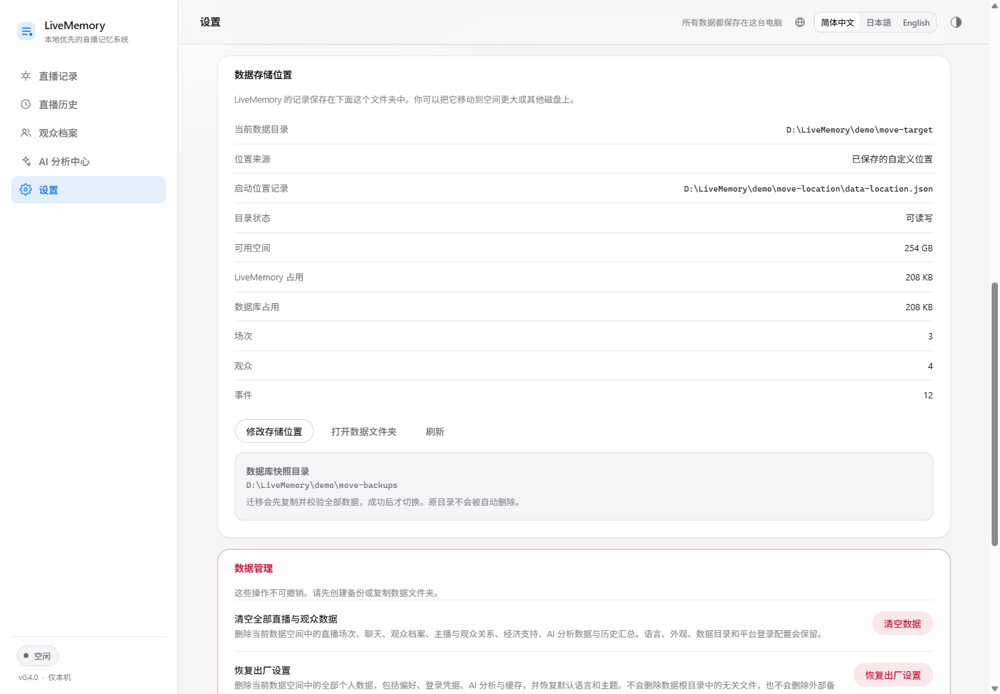

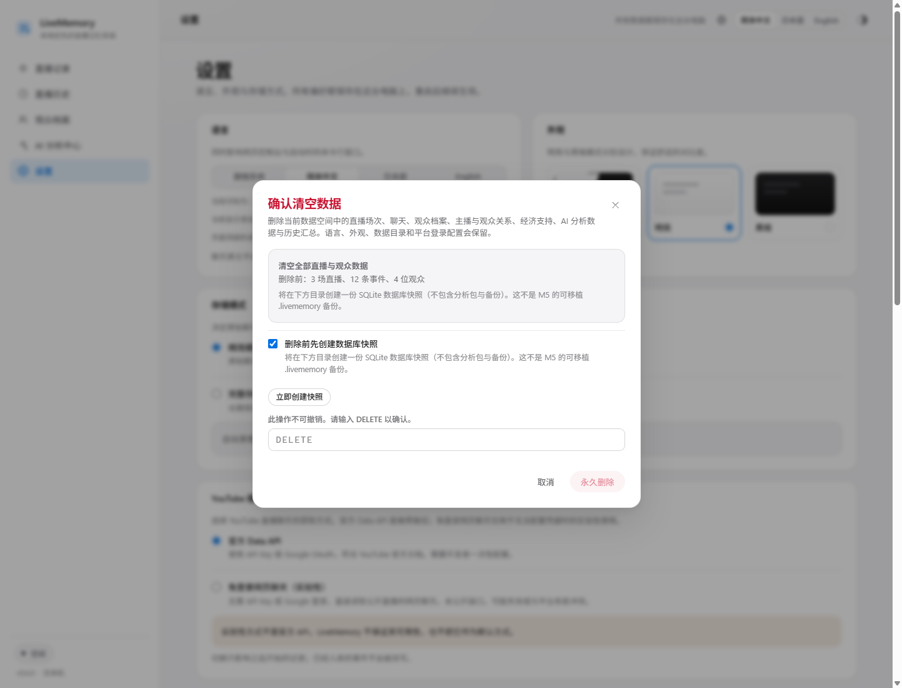

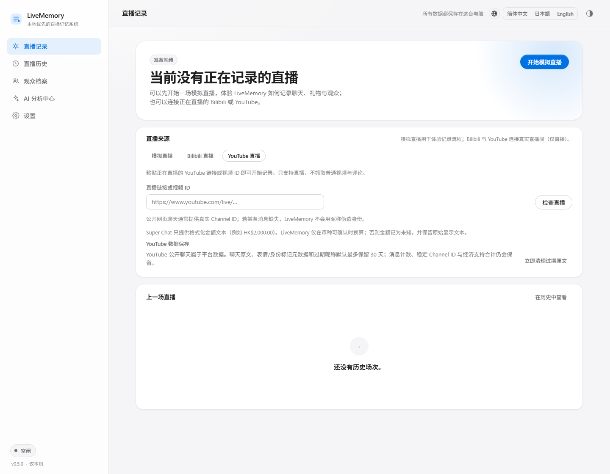

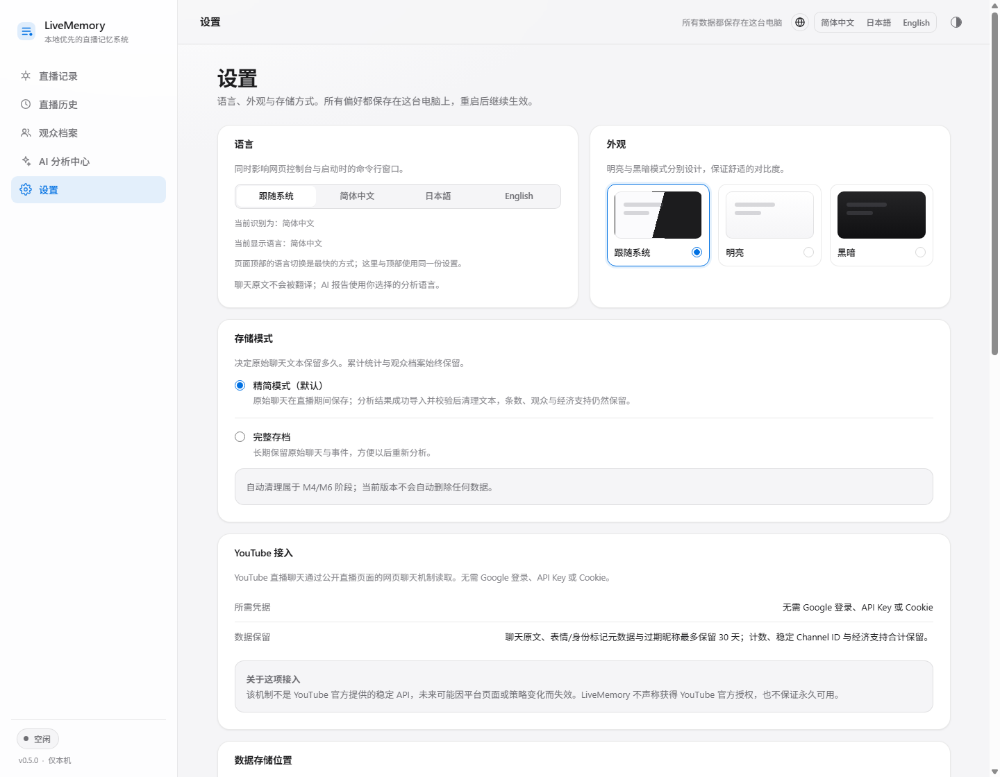

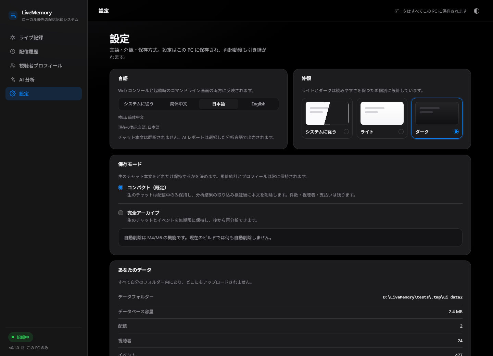

### 尚未完成

真实付费 API 端到端样本（本机没有 Key，阻塞）、真实浏览器 UI 截图（含本轮使用说明页；本机沙箱禁止 Chromium）、真实 Windows 文件对话框点击（备份/恢复代码级与正式 EXE 级已完成，见 `docs/STATUS.md` §0.25）、运行中标签的“隐藏但继续记录”交互、10+ 场长时间压力测试、正式发布版 EXE 的干净环境验收仍未完成。自动监听的真实双平台长跑尚未执行（Bilibili 真实「直播中→下播→再开播」样本仍未捕获；YouTube 真实频道检测只做了少量只读请求，页面结构长期稳定性未验证）。Twitch 的真实 Bits、赠订、真实断网/下播与 EventSub OAuth 仍未验证；订阅/续订与聊天已用真实公开频道验证。统一长期记忆已用 300 位低活跃观众与 1,000 观众 Mock 规模验证覆盖，但真实千人大场与真实 Provider 返回的 `viewer_memory_updates` 仍需样本验证。YouTube 公开网页路径不是官方稳定 API，条款合规性仍未确认。请以 [docs/STATUS.md](docs/STATUS.md) 与 [docs/YOUTUBE_ANONYMOUS_RESEARCH.md](docs/YOUTUBE_ANONYMOUS_RESEARCH.md) 为准。

### YouTube 接入说明

- **不需要** Google 登录、API Key、OAuth 客户端或 Cookie；粘贴正在直播的 YouTube 链接即可，或添加频道开启自动监听。
- 自动监听使用公开的 `/channel/<id>/live` 页面判断是否正在直播（RSS 仅作解析失败时的回退），检测到直播后仍走现有的公开网页聊天；不会下载视频或音频。
- v0.5.0 已删除官方 Data API/OAuth/API Key 双轨实现，只保留公开直播页面的网页聊天。
- 该机制不是 YouTube 官方提供的稳定 API，未来可能失效；LiveMemory 不声称获得 YouTube 授权，也不保证永久可用。
- 不绕过登录、验证码、年龄墙或地区限制；失败时显示真实原因。
- YouTube 数据默认 30 天后清理聊天原文、emote/badge 元数据、金额显示文本与过期昵称；保留统计、稳定 Channel ID 与金额合计，但这不等同于完全删除个人数据（上限 30 天）。

### Twitch 接入说明（M1）

- **不需要** Twitch 账号、OAuth Token、API Key、Cookie 或付费采集服务；粘贴 `twitch.tv/<channel>` 或主播账号即可，或添加频道开启自动监听。
- 聊天通过匿名 IRC（`wss://irc-ws.chat.twitch.tv:443`）读取公开频道；频道 ID、标题、直播状态、观看数与开播时间来自 Twitch 公开网页使用的只读元数据接口。两者都不是官方承诺的稳定 API，未来可能失效。
- 稳定身份使用 IRC `user-id`；昵称只展示。跨场次不会按昵称合并；缺失 ID 的消息不建长期档案。
- 订阅/续订通知已在真实公开频道观测到；**Bits（Cheer）与赠送订阅目前只有解析与自动化测试，尚未观测到真实事件**。官方 EventSub 需要 OAuth、应用 Client ID 与 scope，本构建未配置，也不会要求普通主播注册开发者应用。
- Bits、订阅 Tier、月数与赠订都没有本币金额：`amount_minor=null`、`value_kind=unknown`，只保存数量/档位/展示文本，不换算成主播收入。
- 关播由连续两次公开状态确认；网络错误/429 只重连，不结束。自动监听默认约 2 分钟检查一次（带抖动与退避）。
- Twitch 聊天原文、表情、徽章与展示标签默认 30 天后清理；保留消息计数、稳定 User ID 与金额合计。该窗口在 M1 固定为 30 天，暂未提供设置项。

### 开发运行

需要 Node.js **22.5 或更高**（内置 SQLite）。项目运行时零依赖，无需 `npm install`。

```bat
start.cmd
:: 或者
node src/launcher/launcher.mjs
```

常用参数：

```text
--no-open            启动后不自动打开浏览器
--port <端口>        指定本地端口（默认 47800，占用时自动顺延）
--data-dir <路径>    指定用户数据目录
--forget-data-location  清除已保存的数据目录位置记录，回到默认目录
--lang <语言>        zh-CN | ja | en | ko | es | pt-BR | zh-TW | fr | de | id（控制台语言，与网页语言独立）
--version / --help
```

运行测试：

```bat
node --test tests/unit tests/integration
```

> 在受限环境（禁止子进程）中可使用单进程模式：
> `node --test --test-isolation=none "tests/**/*.test.mjs"`

### 打包 Windows EXE

```bat
node scripts/build-windows.mjs
```

产物为 `dist/LiveMemory.exe`。使用 Node 官方运行时 + SEA 注入，内置 `node:sqlite`，无需在用户机器上编译原生模块。

### 数据与隐私

- 只监听 `127.0.0.1`，端口动态选择，不暴露公网
- 不写入注册表、不写 `Program Files`；发布 EXE 的 Manifest 为 `requireAdministrator`（v0.13.2 RC0-ADMIN），双击时由 Windows 显示标准 UAC 确认
- 本地 `/api/*` 要求启动器建立的随机会话 Cookie（health/auth 除外）；token 不进入 URL 查询串、日志或 runtime.json
- 日志不记录 Cookie、Token、聊天正文；备份默认不包含任何登录凭据
- 关闭控制台窗口应使用 Ctrl+C，程序会刷新数据并关闭数据库

---

## 日本語

LiveMemory は、配信のチャット・ギフト・スーパーチャット・メンバーシップを**自分の PC 上**に記録し、視聴者ごとの長期プロフィールを作るローカル優先のツールです。v0.13.1 以降、AI 分析は**自分で設定した API キー**を使う 1 つの入口だけです。配信・モデル・分析範囲を選び、「AI 分析を開始」を押すと、ローカルプログラムが生成・検証・保存まで行います。匿名無料 AI、プロンプトのコピー、JSON の貼り付けはありません。

- **管理者権限での起動（v0.13.2 RC0-ADMIN）**: 正式 EXE は `requireAdministrator` で、ダブルクリック時に Windows の標準 UAC 確認が表示されます。承認すると管理者として起動し、拒否すると Windows が起動をキャンセルします。右クリックで「管理者として実行」を選ぶ必要はなく、プログラムが UAC を回避・無効化することもありません。
- **単一の AI 分析センター（v0.13.1）**: 配信を選択 → API 設定を選択 → 内容（単一配信／長期プロフィール／両方）→ 費用・予算の確認 → 開始。単一配信レポートと長期プロフィールは別々に保存され、プロフィール失敗でレポートは消えません。プロバイダーごとに独立した同時実行（1–8、既定 3）、429 は `Retry-After`、5xx/タイムアウトは指数バックオフ＋ジッター。匿名無料の 2 リクエスト/分制限はありません。
- **内蔵の十言語ガイド（v0.15.0）**: サイドバーの「使い方」で、初回起動、五つのプラットフォームへの接続、記録と視聴者データ、AI プロバイダーと API キー、単一配信の分析と長期プロフィール、長期メモリと根拠、進捗と失敗からの再開、バックアップ／復元／移行、よくある質問を説明します。ページは読み取り専用で、設定を変更せず、確認ダイアログも出さず、利用制限も追加しません。
- **長期プロフィールの検証・言語・復旧（v0.13.2）**: Compact 回答は Schema・身元・証拠・カバレッジの完全検証を通ります。ref が揃っていても合法とは限りません。修復可能な誤りは最大 1 回だけ自動修復し、再検証後にのみ保存します。モデルは安定した `viewer_id` を書き換えられません。日本語タスクは日本語の意味的事実を生成し、固定英語例は使いません。失敗はバッチ単位で理由と技術情報を保持し、成功した兄弟バッチが消しません。「続行」は未完了バッチだけを実行し、再起動後も回復できます。
- **実規模の信頼性（v0.12.1 の成果を継続）**: モデルにはローカル `ref` だけを返させ、安定した視聴者 ID はプログラムが割り当てます。JSON Schema structured output、打ち切りの記録、欠落視聴者への 1 回だけの限定補完を維持します。
- **履歴（v0.12.0–v0.12.1）**: 匿名無料のワンクリック分析は v0.13.1 で削除しました。当時の調査は `docs/ANONYMOUS_AI_RESEARCH.md` に歴史資料として残しています。

- **自動ライブ監視（v0.10.0）**: Bilibili の配信ルームまたは YouTube チャンネルを一度追加すると、アプリの実行中に配信開始を検出して自動で記録を開始し、終了を検出して保存したあと次の配信を待ちます。**監視タブは 1 回の配信ではなくルーム／チャンネルに対応し、配信が終わっても消えません**。次回は同じタブで新しい独立した記録が始まります。Bilibili は固定ルーム ID と低頻度の公開状態確認、YouTube は公開チャンネルの `/live` ページ（解析失敗時は RSS にフォールバック）を使い、**Google Data API / OAuth / API キー / Cookie は不要**です。待機中は読み取り専用の低頻度確認（Bilibili 約 1 分、YouTube 約 3 分、ジッターと指数バックオフ付き）のみを行い、ネットワーク切断を配信終了とは扱いません。監視の一時停止／再開、今すぐ確認、対象の削除ができ、対象を削除しても過去の配信記録は残ります
- **1 回の AI 分析で配信レポートと長期メモリを同時更新（v0.11.0）**: AI 分析センターが書き出す 1 つのタスクに、今回のチャット、**識別可能な全視聴者**、各視聴者の今回の発言抜粋、既存の長期メモリと客観的な交流統計を含めます。ユーザーは 1 回書き出し、1 回 AI に渡し、1 回取り込むだけです。取り込み時は同じトランザクションで配信レポートを保存し、長期メモリを差分更新します。最低発言回数・最低活躍度・Top N の条件はなく、1 配信に 1 言だけの視聴者も配信数・初回/最近・発言数・支援・意味メモリを積み重ねます
- **客観的な交流履歴と AI の意味メモリを分離**: 初回/最近・配信数・発言数・支援は実データから決定論的に更新し、AI は変更できません。興味・経験・状態変化だけを AI が提案し、根拠または inferred / uncertain の区別が必要です。挨拶やギフトだけの場合は新しい意味メモリがなくても「処理済み」として扱い、交流履歴は蓄積します
- **独立した長期メモリ・ワークフローを廃止**: `長期メモリ` の独立ページは削除し、旧ブックマークは AI 分析センターへ移動します。視聴者詳細の長期メモリタブは残し、要約・**客観的な交流履歴**・興味・最近の変化・根拠・履歴バージョン・確認/修正/削除を表示します
- **視聴者プロフィールの配信者範囲を実データに限定（v0.11.1）**: 個別視聴者の詳細では、その視聴者が実際に交流した配信者だけを表示します（チャット、ギフト、SC、メンバーシップなど識別可能な交流）。同名でもプラットフォーム/安定 ID が異なる視聴者は統合しません。配信者が 1 人だけの場合は不要な選択肢を表示せず、関連がなければ明示的な空状態を表示し、全配信者へフォールバックしません。
- **長期メモリのデータモデル（v0.9.0 から継続）**: 「配信者 × 視聴者」ごとに 1 つの長期メモリ。各事実は出典の配信・引用メッセージ・時刻・確度（本人が明言 / AI の推測 / 未確認）と状態（現在 / 古い可能性 / 矛盾 / 置換済み / 確認待ち）を持ちます。状態変化は置換として履歴を残し、上書きしません。バージョンは復元でき、削除後の古いパッケージでは復活しません
- **視聴者プロフィールのタブ**: 概要 / 長期メモリ / 交流履歴 / バージョン。根拠の原文を開く、推測を確認/無視する、1 件を忘れる、以前のバージョンへ戻す、視聴者 1 人の長期メモリを削除する、が可能です
- 対応 UI / コンソール: 简体中文・日本語・English（システム言語に追従、手動変更は保存されます）。起動コンソールは既定で英語、`--lang` で切り替え可能
- **複数配信の同時記録**: 配信ごとに独立したタブ・接続状態・統計・停止操作。同じ配信ルームの重複起動は拒否され、1 件の失敗/停止は他に影響しません
- **ライブ記録タブ**: 固定の「新規記録」と横スクロール可能な配信タブ。接続中/記録中/再接続中/停止済み/接続失敗を表示。ページ移動や再読み込みでもバックグラウンド記録は継続します
- **今の配信のトップ 100 視聴者**: 有効なチャット数順、約 10 行表示＋スクロールで最大 100 名、検索・安定した同順位ソート・配信者コンテキスト付きプロフィール遷移
- **配信履歴の管理**: 一覧/詳細から1配信だけ停止（他は継続、プラットフォーム配信の終了ではありません）、アーカイブ/解除、完全削除。アーカイブは既定で非表示ですが表示切替でき、再起動後も維持
- **配信履歴の検索・絞り込み**: 配信者（名前/安定 ID）、タイトル（中・日・英・混在）、視聴者（安定 ID/ニックネーム/過去のニックネーム）。同名でもプラットフォーム/ID が違えば別身份のまま。プラットフォーム・状態・日付・アーカイブ条件を組み合わせ可能。一致理由を表示し、その視聴者のこの配信での発言も確認できます
- **完全削除**: トランザクションでメッセージ・イベント・支援・統計・視聴者参加・AI パッケージ/ファイルを削除し、他の配信にも参加する視聴者/配信者の集計を再計算。その配信だけの視聴者は削除。失敗時はロールバックし、検索や視聴者プロフィールに残りません
- テーマ: システムに従う / ライト / ダーク（個別設計・再起動後も維持）
- 対応: 起動・設定・模擬配信の記録・履歴・視聴者一覧・AI 分析パッケージ出力・Bilibili 実配信（チャット/絵文字）・YouTube 実配信（Super Chat / Super Sticker / メンバー / 多通貨）・Twitch 実配信（匿名 IRC チャット、安定 User ID、サブスク/再サブスク）
- YouTube は公開ライブページの Web チャットのみを使用します。Google ログイン、API キー、OAuth、Cookie は不要です。この仕組みは YouTube の公式で安定した API ではなく、プラットフォームの変更により利用できなくなる可能性があります。設定/プライバシー説明にのみ短く記載し、接続のたびにモード警告を出しません
- チャット本文・絵文字/バッジ・金額表示・古いニックネームは YouTube のポリシーに合わせて既定 30 日で削除し、統計・安定した Channel ID・金額合計は保持します（完全な個人データ削除ではありません）
- **Twitch（M1）**: 匿名 IRC の公開チャットと公開メタデータを使用し、Twitch ログイン、OAuth、API キー、Cookie、有料収集サービスは不要です。実際の公開チャンネルで安定した User ID・メッセージ ID・Unicode・絵文字 ID・サブスク/再サブスク通知を確認済みです。**Bits とギフトサブスクは解析済みですが、実イベントは未確認**です。Bits/Tier/月数は実際の金額ではないため換算しません。公式 EventSub（OAuth）は本ビルドでは未設定です
- AI 分析は「パッケージ出力 → 任意の AI に手動で渡す → JSON を取り込む」方式です。M6 で **メッセージ境界の自動分割、三言語プロンプト（バージョン記録）、JSON ファイル/貼り付け取り込み、厳格な Schema・場面・配信者・視聴者・時刻・メッセージ参照検証、重複取り込み防止、結果バージョン、第 2 段階の統合パッケージ、分析レポート**を実装しました。手動フローは AI API を呼びません。v0.12.0 の自動フローは、ユーザーが同意した場合にだけ検証済みの匿名サービスを呼びます。
- **分析レポート**: 配信要約、話題タイムライン、感情の変化、論争、見返し候補、視聴者プロフィール、プロンプト/結果バージョンと出所。根拠は実際のメッセージに解決され、原文が保持期間で消えている場合は「利用不可」と明示します。映像・音声は分析していないことも明記します
- AI 結果は外部入力として扱い、HTML/スクリプトを実行せず、金額・件数・設定を変更できません。同一結果の再取り込みは重複として扱い、異なる結果は明示的に新しいバージョンとして追加します
- AI 结果の長期保存（視聴者プロフィールを含む）は v0.9.0 の長期メモリで扱います。ただし YouTube の 30 日クリーンアップ後は根拠が「原文削除済み」となり、メモリ自体は残ります。プラットフォームポリシーへの完全準拠を主張してはいけません
- ポータブルバックアップは今後実装予定

開発時は Node.js 22.5 以降が必要です（SQLite は実行環境に内蔵）。詳細は [docs/STATUS.md](docs/STATUS.md) と [docs/WINDOWS_RUNTIME.md](docs/WINDOWS_RUNTIME.md) を参照してください。

---

## English

LiveMemory records chat, gifts, Super Chats and membership events **on your own computer**, and builds long-term viewer profiles keyed by stable platform IDs. All AI analysis uses **your own API key** and is called directly by the local program. There is no anonymous free AI, no manual prompt/JSON round trip, no cloud account and no developer server.

**v0.13.2 RC0-ADMIN restores the administrator manifest**: double-clicking the EXE shows the standard Windows UAC prompt; accepting starts it with administrator rights, and declining simply cancels the launch. Users do not need to right-click and choose Run as administrator, and the program never bypasses or disables UAC.

**v0.15.0 ships ten interface languages**: 简体中文, 日本語, English, 한국어, Español, Português (Brasil), 繁體中文, Français, Deutsch and Bahasa Indonesia cover the whole console, the built-in user guide and the Windows launcher. The AI output language is a **separate** persisted setting (default: follow the interface language), and the ten languages are supported for session reports, long-term profiles and report reading translation.

**v0.15.0 upgrades the built-in guide to ten languages**: the sidebar's User guide (`#/help`) explains first launch, connecting the five platforms, recordings and viewer data, AI providers and API keys, single-session analysis and long-term profiles, long-term memory and evidence, analysis progress and recovery, backup/restore/migration and common questions. The page is read-only: it changes no settings, shows no confirmation dialogs and adds no usage limits.

Current build (v0.13.1) delivers the Windows administrator-manifest launcher, tri-language Apple-style console with a header language switch, theme system, persistent settings, a real five-platform recording pipeline backed by SQLite, **concurrent recording of multiple Bilibili/YouTube broadcasts with browser-style tabs and per-stream state**, **Bilibili platform-live detection with automatic stop on `PREPARING`/`live_status` confirmation while other broadcasts keep recording**, **a scrollable Top 100 current-session leaderboard with search and broadcaster-aware viewer links**, **per-broadcast stop / archive / permanent delete managed from one shared implementation**, **history search by broadcaster, title or viewer with platform/status/date/archive filters and match reasons**, real Bilibili chat with Unicode emoji and platform emotes, and **one** YouTube path: the public live web chat, with no Google login, API key, OAuth or cookie. That mechanism is not an official stable API and may stop working; the UI explains it once in settings/privacy instead of showing a mode selector on every connection. All platforms feed one canonical pipeline, per-currency totals, a 30-day retention policy, session history, viewer profiles and AI analysis. **v0.13.1 replaces the manual/anonymous AI entry points with one API-key analysis centre**: choose a broadcast, provider/model, scope, review price and budget, then start. Session and long-term memory jobs are saved separately; memory batches run with bounded concurrency; 429 respects `Retry-After`; retries use exponential backoff with jitter; request statistics separate model time from local queue and throttle waits. Deleting one session runs in a single transaction, removes its AI tasks/results/evidence and packages, and recomputes the remaining viewer/broadcaster aggregates. A stable platform account can appear for multiple broadcasters while its interaction context stays per broadcaster (schema v13). The data folder can be moved with verification and rollback, and users can clear recorded data or restore factory settings with confirmation and an off-folder database snapshot. Real paid-provider verification remains blocked on this machine because no API key is configured; see [docs/STATUS.md](docs/STATUS.md) and [docs/AI_SCHEDULER_AUDIT.md](docs/AI_SCHEDULER_AUDIT.md).

**M7 (v0.9.0) adds long-term viewer memory**: one memory per broadcaster × viewer, holding atomic facts with source session, quoted message, timestamp, certainty (stated / inferred / uncertain) and status (current / possibly outdated / contradicted / superseded / needs confirmation). A state change such as "preparing for an exam" → "the exam is over" is stored as a supersede with history instead of overwriting. Updates can be merged locally from an already-imported session analysis (no AI at all) or through a versioned memory update package (`livememory-memory-update-v1`) that any AI can answer; the app validates viewer ids, quoted messages, target facts and schema before showing the exact per-viewer diff, then applies it as a new version in one transaction. Re-importing the same answer changes nothing, every update can be rolled back, a human can confirm or forget a single fact, and deleting one viewer's memory blocks older packages from restoring it. Viewer profiles now have Overview / Long-term memory / Interaction history / Versions tabs, and a Memory workspace walks through the whole round trip.

**v0.11.0 makes long-term memory part of the normal AI analysis import**: one exported task now contains the session report context AND every identifiable viewer, each viewer's complete session excerpts, their existing long-term memory and objective interaction history. The user exports once, asks any AI once, and imports once; the import saves the session report and applies the memory increment in the same transaction. There is no minimum message count, activity threshold or Top-N cut, and viewers whose messages fall in different batches are assigned to exactly one memory batch so their excerpts are never split. Objective history (first/last seen, sessions, messages, support) is updated deterministically from real records and cannot be written by AI; a greeting or gift-only viewer is still processed and marked as "no new semantic information". The standalone Memory workspace was removed; the viewer detail page keeps the long-term memory tab with objective history, facts, evidence, changes and versions.

**v0.11.1 fixes the viewer-detail broadcaster scope**: the picker now lists only the broadcasters that viewer actually interacted with (chat, gifts, SC, memberships and other identifiable events), never the global broadcaster list. Same-name viewers on different platforms or stable IDs stay separate. A single related broadcaster is shown read-only instead of a one-option dropdown, and a viewer with no related broadcaster gets an explicit empty state rather than falling back to all channels.

**v0.12.0–v0.12.1 (historical) added one-click anonymous AI analysis**. That entry point has been removed in v0.13.1; its reliability work survives in the automatic path: the model returns only compact refs, the local program maps them to stable viewer ids, JSON Schema structured output and truncation detection are enforced, missing viewers trigger one bounded targeted supplement, and every answer goes through the same strict validator and transaction importer. See [docs/ANONYMOUS_AI_RESEARCH.md](docs/ANONYMOUS_AI_RESEARCH.md) for the historical anonymous-provider research.

**v0.13.0 separated the session report from long-term viewer profiles**. v0.13.1 keeps that split and removes the manual/anonymous entry points: a paid model that passes the dedicated capability test can opt in to long-term viewer memory; it receives compact refs, never copies stable viewer ids, and every batch is validated and imported independently. Providers include OpenAI, Anthropic, DeepSeek, MiniMax (CN/international), Alibaba Cloud Model Studio (four regions), OpenRouter and custom OpenAI-compatible endpoints. API keys are encrypted locally, region changes rotate credentials, custom URLs are checked for private/metadata targets, and paid/unknown models require explicit billing confirmation plus a per-task budget. Session reports and memory jobs are saved separately; memory batches use bounded concurrency; 429 respects `Retry-After`; retries use exponential backoff with jitter. A real paid-provider run is still blocked on this machine because no key is configured; Mock scale tests and the audit are in [docs/AI_SCHEDULER_AUDIT.md](docs/AI_SCHEDULER_AUDIT.md). The v0.13.1 usability pass fixes history-to-AI selection by stable session id, distinguishes a saved API key from an untested/failed/missing one, adds counted live progress, keeps the session report when memory has no identifiable viewers, prevents duplicate report mounting, resolves Bilibili anchor names while offline through the public master endpoint, and persistently suppresses automatic re-capture for the same live cycle after a manual stop. Saved API configurations can now be edited in place: changing only the model keeps the encrypted key, resets the old model's capability verdict and price, and running tasks keep their start-time snapshot.

**v0.12.1 fixes the real first-use failures**: automatic batches now ask the model only for a local `ref` plus semantic content; the app maps each ref to the exact stable viewer id, so the model never copies, invents or merges identities. Requests use JSON Schema structured output, record `finish_reason`, and report truncation or repetition separately. Missing viewers trigger one bounded targeted supplement; if they are still missing the run fails instead of pretending they had no information. A real 52-viewer / 99-message / 6-batch run completed with 52/52 coverage. Manual imports now expose `missing` / `unknown` / `duplicate` viewer gaps with nicknames and a copyable repair instruction; ids are never silently rewritten. The manual prompt also lost a self-contradictory "do not output viewer identity" rule that was present in all three languages.

Streamers never create an API key, OAuth client or Google Cloud project. The public-web path was re-validated in v0.6.0 with real concurrent captures (two YouTube broadcasts, YouTube + Bilibili, three streams, and the built EXE attached to the same three streams). Its terms compliance remains unconfirmed (see [docs/STATUS.md](docs/STATUS.md) and [docs/YOUTUBE_ANONYMOUS_RESEARCH.md](docs/YOUTUBE_ANONYMOUS_RESEARCH.md)).

**M1 adds Twitch Live through anonymous IRC plus read-only public channel metadata**: no Twitch account, OAuth token, API key, cookie or paid collection service. Real public channels confirmed stable user IDs, message IDs, Unicode, emote IDs and subscription/resub notices. Bits and gifted subscriptions are parsed and unit-tested but have not yet been observed as real events; EventSub (official OAuth) is not configured. Bits, tiers and gifted months are never converted into income. Twitch raw chat text is purged after 30 days; counts and stable IDs are kept. See [docs/PLATFORM_INTEGRATIONS.md](docs/PLATFORM_INTEGRATIONS.md) §3A and [docs/STATUS.md](docs/STATUS.md).

**v0.10.0 adds automatic live monitoring**: add a Bilibili room or a YouTube channel once and LiveMemory detects the next broadcast, records it, detects the end, saves it, and waits for the next one. **The monitoring tab belongs to the room/channel, not to a single broadcast**, so it stays after a stream ends and the next broadcast becomes a new, independent recording in the same tab. Bilibili uses its fixed room id plus a low-frequency public status check; YouTube uses the public channel `/live` page (with an RSS fallback) and still needs no Google Data API, OAuth, API key or cookie. Checks run only while a target is not recording (about 1 minute for Bilibili, 3 minutes for YouTube, with jitter and exponential backoff), and a network failure is never treated as the end of a broadcast. Targets can be paused, resumed, checked on demand or deleted without deleting the broadcasts they produced. The research and licence comparison behind this route are in [docs/YOUTUBE_AUTO_DISCOVERY.md](docs/YOUTUBE_AUTO_DISCOVERY.md).

```bat
start.cmd            :: development
node scripts/build-windows.mjs   :: LiveMemory.exe
```

Node.js 22.5+ is required for development runs. There are no runtime dependencies.

---

## 文档 / Documents

| 文档 | 内容 |
| --- | --- |
| [AGENTS.md](AGENTS.md) | 开发规则：每轮必读、命令、提交约定 |
| [docs/PRODUCT.md](docs/PRODUCT.md) | 产品定位与验收标准 |
| [docs/STATUS.md](docs/STATUS.md) | 真实工程状态（唯一进度来源） |
| [docs/HANDOFF.md](docs/HANDOFF.md) | 跨对话交接 |
| [docs/ROADMAP.md](docs/ROADMAP.md) | M0–M8 里程碑 |
| [docs/ARCHITECTURE.md](docs/ARCHITECTURE.md) | 模块边界与数据流 |
| [docs/DATA_MODEL.md](docs/DATA_MODEL.md) | 数据库、身份、金额、生命周期 |
| [docs/AI_CONTRACT.md](docs/AI_CONTRACT.md) | 分析包与结果 Schema 协议 |
| [docs/PLATFORM_INTEGRATIONS.md](docs/PLATFORM_INTEGRATIONS.md) | 平台接入现状与限制 |
| [docs/YOUTUBE_ANONYMOUS_RESEARCH.md](docs/YOUTUBE_ANONYMOUS_RESEARCH.md) | 开源方案、许可证、真实采样与条款风险 |
| [docs/YOUTUBE_AUTO_DISCOVERY.md](docs/YOUTUBE_AUTO_DISCOVERY.md) | 无 API Key 的 YouTube 自动开播发现：调研、比较、实测与限制 |
| [docs/BACKUP_RESTORE.md](docs/BACKUP_RESTORE.md) | 备份/恢复用户流程、事务与崩溃回滚 |
| [docs/BACKUP_FORMAT.md](docs/BACKUP_FORMAT.md) | `.livememory` v1 格式、完整性、安全与错误码 |
| [docs/WINDOWS_RUNTIME.md](docs/WINDOWS_RUNTIME.md) | EXE、启动器、权限、单实例 |
| [docs/UI_DESIGN.md](docs/UI_DESIGN.md) | 视觉规范、主题、响应式、多语言 |
| [docs/PRIVACY_SECURITY.md](docs/PRIVACY_SECURITY.md) | 本地监听、凭据、导入安全 |
| [docs/TEST_PLAN.md](docs/TEST_PLAN.md) | 测试策略与验收记录 |
| [docs/DECISIONS.md](docs/DECISIONS.md) | ADR |
| [docs/RELEASE.md](docs/RELEASE.md) | 打包与发布流程 |
| [docs/CHANGELOG.md](docs/CHANGELOG.md) | 版本变化 |

## License

MIT © 2026 zgrg29
