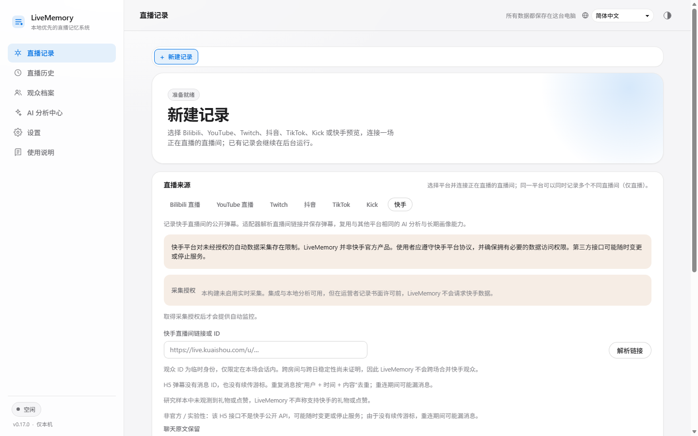
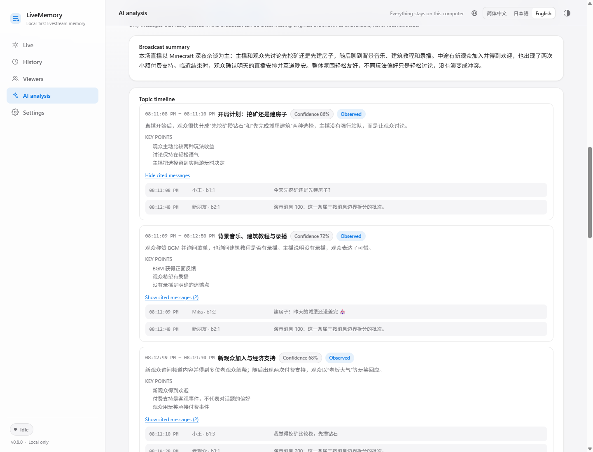

# LiveMemory

**Local-first livestream memory for streamers.** Record live chat and interactions, keep long-term viewer profiles on your own PC, and analyze broadcasts with your own AI provider.

[English](#english) · [简体中文](#简体中文) · [日本語](#日本語)

[](https://github.com/zgrg29/LiveMemory/releases/latest)
[](LICENSE)
[](#download-and-install)
[](#faq)

> **Current release: v0.17.0.** Six live platforms are released and usable. **Kuaishou is a preview only**: link parsing and the local UI are present, but live capture is disabled in public builds and Kuaishou is **not** a supported capture platform. See [Platform support](#platform-support).

---

## English

### What is LiveMemory?

LiveMemory is a free, local-first Windows application for streamers who want to remember their audience.

It records live chat and interactions from supported platforms, keeps a per-viewer history keyed by each platform's stable user ID, and turns that history into **session reports** and **long-term viewer profiles** using an AI provider that you configure yourself.

Everything runs on your computer. There is no LiveMemory account, no developer-run server, and no telemetry. AI requests are sent directly from your PC to the provider whose API key you entered.

**At a glance**

- **Local-first** — chat, statistics, profiles and AI reports stay in `%LOCALAPPDATA%\LiveMemory\`.
- **Six live platforms** — Bilibili, YouTube, Twitch, Douyin, TikTok and Kick.
- **Multiple rooms at once** — each recording has its own tab, connection state and stop button.
- **Ten interface languages** — plus ten independent AI output languages.
- **Bring your own AI key** — OpenAI, Anthropic Claude, DeepSeek, MiniMax, Alibaba Cloud Model Studio, OpenRouter, OpenCode or any OpenAI-compatible endpoint.



### Core features

- **Multi-platform live chat and interaction recording.** Capture public live chat, viewer names, stable platform IDs, timestamps, emotes and supported paid interactions.
- **Several recordings at the same time.** Record multiple rooms or channels in parallel. Each recording is isolated; stopping or failing one does not affect the others.
- **Automatic live monitoring.** Add a room or channel once. While LiveMemory is running it checks for the next broadcast, starts recording when it goes live, detects the end, saves the session, and waits for the next one.
- **Single-session analysis.** Generate a broadcast summary, topic timeline, sentiment changes, discussion hotspots, moments worth revisiting and viewer observations. The analysis uses chat and events only — not video or audio.
- **Long-term viewer memory.** Keep one profile per broadcaster × viewer, with objective interaction history and evidence-backed semantic facts. Objective counts are updated deterministically from real records; AI never rewrites them.
- **Progress and recovery.** Long analyses are split into batches. Completed work is saved, failed batches explain why, and an interrupted job can continue without re-sending completed work.
- **Report translation.** Read a saved report in another language without re-running the analysis. The original text and structured fields stay unchanged.
- **Local data, backup and migration.** Create a single `.livememory` backup, restore it on the same or another Windows PC, or move the data folder from Settings.



### Platform support

| Platform | Status | How it connects | Live chat | Auto-monitor | Notes |
| --- | --- | --- | --- | --- | --- |
| **Bilibili Live** | Released | Public live API; optional QR login | ✅ Verified | ✅ | Optional login improves viewer identity. Without login, some messages may have masked nicknames and no stable UID. Gifts/Super Chats/guard events are mapped; real gift events have not been observed, so they are not presented as verified. |
| **YouTube Live** | Released | Public live-page web chat; no Google login, API key or cookie | ✅ Verified | ✅ | Uses a public web path, not an official stable API. It may break when YouTube changes its pages. Super Chat/memberships are mapped; real paid-event samples are limited. |
| **Twitch** | Released | Anonymous IRC + public channel metadata | ✅ Verified | ✅ | Chat, subscriptions and resubscriptions observed in real channels. Bits and gifted subscriptions are parsed but not yet observed as real events. |
| **Douyin Live** | Released | Anonymous webcast WebSocket | ✅ Verified | ✅ | Chat and stable UIDs verified. Gifts require login; real phone QR login and real gift events are not fully verified. |
| **TikTok Live** | Released, experimental protocol | Anonymous local webcast WebSocket | ✅ Verified | ✅ | Unofficial protocol with no resume cursor; messages can be missed during reconnects. Gifts are `NOT-OBSERVED`. |
| **Kick** | Released | Anonymous Centrifugo frontend feed | ✅ Verified | ✅ | KICKs and gifted subscriptions observed in a real long run. KICKs are not converted to currency. |
| **Kuaishou** | **Preview — live capture disabled** | Link parsing only in public builds | — | — | Not a supported capture platform. No Kuaishou network requests are made in public builds; see [Kuaishou notes](#kuaishou-preview). |

**Not supported yet:** Huya, Douyu, CHZZK, SOOP, Niconico, Xiaohongshu, YY and Facebook Live. No support is implied for platforms not listed as released above.

> **What "Released" means:** the platform is included in a public release and has passed the acceptance level recorded in [docs/PLATFORM_INTEGRATIONS.md](docs/PLATFORM_INTEGRATIONS.md). Some paid interactions are mapped but not yet observed in real sessions; those are marked `NOT-OBSERVED` and are never presented as verified. "Experimental" means the connection relies on a non-public protocol that may change without notice.

#### Kuaishou preview

The Kuaishou tab is a **preview component**. URL parsing, local storage, AI analysis, viewer profiles within one session and monitoring scaffolding are integrated, but **live H5 collection is disabled by default**. In a public build, `connect` returns an authorization-required error before any network request is made.

Kuaishou has not granted written permission for automated collection. The public build therefore does not collect Kuaishou chat, gifts or likes, does not merge viewers across sessions, and does not claim Kuaishou support. Details: [docs/KUAISHOU_H5_INTEGRATION.md](docs/KUAISHOU_H5_INTEGRATION.md).

### Download and install

**Windows 10 or Windows 11, 64-bit.**

1. Open **[GitHub Releases](https://github.com/zgrg29/LiveMemory/releases/latest)**.
2. Download **`LiveMemory.exe`**. Download `SHA256SUMS.txt` too if you want to verify the file.
3. Double-click `LiveMemory.exe`.

Direct links for the latest release:

- [Download LiveMemory.exe](https://github.com/zgrg29/LiveMemory/releases/latest/download/LiveMemory.exe)
- [Download SHA256SUMS.txt](https://github.com/zgrg29/LiveMemory/releases/latest/download/SHA256SUMS.txt)

**Windows UAC.** The published EXE is built with `requireAdministrator`, so Windows shows a standard UAC prompt when you double-click it. Choose **Yes** to start; choosing **No** cancels the launch. You do **not** need to right-click and choose "Run as administrator", and LiveMemory does not bypass or disable UAC. User data is still stored in your normal user profile, not in `Program Files`.

**SmartScreen.** The EXE is not code-signed, so Windows may show "Unknown publisher". You can verify the SHA-256 against `SHA256SUMS.txt` and then choose **More info → Run anyway**.

**No extra dependencies.** You do **not** need Python, Node.js, npm or a database. The EXE contains its own runtime and uses the built-in SQLite engine.

**Where data lives.** By default: `%LOCALAPPDATA%\LiveMemory\`. You can move it in **Settings → Data location**. Only one LiveMemory instance can write to the same data folder at a time.

### Quick start

1. **Download and start** `LiveMemory.exe` (accept the UAC prompt).
2. Open **Live** and add a live room or channel: paste a Bilibili room ID, a YouTube live URL, a Twitch channel, a Douyin/TikTok link, or a Kick channel URL.
3. Click **Check room**, then **Start recording** — or enable **Auto-monitor** to start automatically the next time the stream goes live.
4. Watch chat, viewer counts and the Top 100 in the **Live** tab. Each additional room gets its own tab.
5. Open **History** to review a finished session, search viewers, and see the timeline and totals.
6. Open **Settings → AI providers**, choose a provider, enter your own API key and model ID, and run the capability test.
7. Open **AI analysis**, select the session, choose the scope (session report, long-term profiles, or both), and start. Results are saved locally.
8. Create a backup in **Settings → Backup & restore** before upgrading or moving to another PC.

### AI analysis

- **You bring the provider and the key.** LiveMemory does not include a shared AI service and does not provide an anonymous free AI. Supported providers: OpenAI, Anthropic Claude, DeepSeek, MiniMax (China mainland / international), Alibaba Cloud Model Studio (Beijing / Singapore / US / Hong Kong), OpenRouter, OpenCode (pay-as-you-go or Go) and custom OpenAI-compatible endpoints.
- **Requests go directly to your provider.** The local program sends the request from your computer to the base URL you configured. LiveMemory's developers do not operate a proxy or relay for AI traffic.
- **AI usage may cost money.** You pay your provider directly. Prices shown in the app are estimates based on the values you enter; they are not a bill.
- **AI output can be wrong.** Summaries, inferred interests and profile facts may be inaccurate or incomplete. Treat them as suggestions, not facts. Evidence and certainty labels are shown so you can check them.
- **AI never changes objective statistics.** Message counts, gift totals, payments, viewer identities and session history are written by the local recording pipeline, not by the model.
- **Language is independent.** The interface language and the AI output language are separate settings. A Korean interface can produce a Japanese report. A task's language is fixed when it is created, and saved report text is not silently rewritten.
- **Original chat is never translated in storage.** The model reads the original chat; translations are display-only and are stored separately.

### Data and privacy

- **Local by default.** The console is served on `127.0.0.1` only. Local API calls require a per-launch session cookie. There is no account system, cloud sync or telemetry.
- **Credentials are protected locally.** API keys and platform login cookies are stored in an encrypted local credential store (AES-256-GCM), not in the settings JSON, logs, HTML or backups.
- **Backups are not encrypted.** A `.livememory` backup contains sessions, chat, viewer profiles, AI reports and settings. It excludes API keys and platform cookies, but it still contains personal viewer data. Store and transfer it carefully.
- **External AI transfer.** When you run an analysis or a translation, the relevant chat excerpts and context are sent to the provider you configured. That provider's terms and privacy policy apply to that data.
- **Platform retention.** For YouTube, Twitch, Douyin, TikTok, Kick and the Kuaishou preview, raw chat text, emotes/badges and expired nicknames are removed after the 30-day retention window. Counts, stable IDs and totals remain. This is not complete anonymization. Bilibili recordings remain in your local database until you delete them.
- **Unofficial connections.** YouTube, Twitch, Douyin, TikTok, Kick and Kuaishou are reached through public or non-public web interfaces, not official partner APIs. They can change or stop working. LiveMemory reports failures instead of pretending a connection succeeded.

### FAQ

**Do I need administrator rights?**
The published EXE requests administrator rights through the standard Windows UAC prompt. Accept it to launch. The app does not require you to disable UAC or run it with a special shortcut.

**Windows says "Unknown publisher". Is that normal?**
Yes — the EXE is not code-signed. Verify the SHA-256 from `SHA256SUMS.txt` if you want extra assurance.

**Do I need Python, Node.js or a database?**
No. The EXE is self-contained. Node.js 22.5+ is only needed if you run the source code as a developer.

**Where is my data? How do I move it?**
`%LOCALAPPDATA%\LiveMemory\` by default. Use **Settings → Data location** to move it, or create a backup and restore it on another PC.

**Does LiveMemory download or record video/audio?**
No. It records chat, viewer and interaction data. AI analysis works on chat and events only.

**Can I use it without an AI provider?**
Yes. Recording, history, viewer profiles, search and backups work without any AI configuration. AI analysis requires your own provider and key.

**Why is Kuaishou not collecting chat?**
It is a preview. Public builds keep Kuaishou capture disabled because written platform permission has not been obtained. Link parsing is local only.

**Which languages are supported?**
The interface is available in Simplified Chinese, Japanese, English, Korean, Spanish, Brazilian Portuguese, Traditional Chinese, French, German and Indonesian. AI output supports the same ten languages as a separate setting.

**Does it run on macOS or Linux?**
No. The published application is Windows-only.

**Known limitations.** Some platform connections use unofficial web endpoints and can stop working. Some paid interaction types have not been observed in real sessions. Bilibili viewer identity can be incomplete without login. The EXE is unsigned and has not been validated on every Windows configuration. The app is Windows-only.

### Support

Need help or found a bug? Open a **[GitHub Issue](https://github.com/zgrg29/LiveMemory/issues)**. Please include the LiveMemory version (Settings → About or `--version`), your Windows version, what you expected, and what happened. Do not paste API keys, cookies or private chat contents.

### Development

Requirements: **Node.js 22.5 or newer**. The runtime has zero dependencies, so no `npm install` is needed.

```bat
:: Run from source (opens the console)
start.cmd
:: or
node src/launcher/launcher.mjs

:: Run tests
node --test tests/unit tests/integration

:: Build the Windows EXE
node scripts/build-windows.mjs
```

Useful flags: `--no-open`, `--port <port>`, `--data-dir <path>`, `--lang <code>`, `--version`, `--help`.

Architecture, data rules, platform admission, i18n rules and test strategy are documented under [docs/](docs/). Start with [AGENTS.md](AGENTS.md), then [docs/STATUS.md](docs/STATUS.md), [docs/HANDOFF.md](docs/HANDOFF.md) and [docs/ROADMAP.md](docs/ROADMAP.md).

### Documentation

| Document | What it covers |
| --- | --- |
| [docs/STATUS.md](docs/STATUS.md) | Current engineering state and open items (single source of progress truth) |
| [docs/HANDOFF.md](docs/HANDOFF.md) | Latest development handoff |
| [docs/ROADMAP.md](docs/ROADMAP.md) | Current milestone and future work |
| [docs/CHANGELOG.md](docs/CHANGELOG.md) | Release-by-release changes |
| [docs/PLATFORM_INTEGRATIONS.md](docs/PLATFORM_INTEGRATIONS.md) | Platform protocols, verified fields and limitations |
| [docs/PLATFORM_ADMISSION.md](docs/PLATFORM_ADMISSION.md) | Rules for adding a new platform |
| [docs/I18N.md](docs/I18N.md) | Language model, UI languages and AI output languages |
| [docs/AI_CONTRACT.md](docs/AI_CONTRACT.md) | Analysis package and result protocol |
| [docs/AI_PROVIDER_COMPATIBILITY.md](docs/AI_PROVIDER_COMPATIBILITY.md) | Provider capabilities and compatibility notes |
| [docs/ARCHITECTURE.md](docs/ARCHITECTURE.md) | Module boundaries and data flow |
| [docs/DECISIONS.md](docs/DECISIONS.md) | Architecture decision records |
| [docs/BACKUP_RESTORE.md](docs/BACKUP_RESTORE.md) | Backup, restore and migration |
| [docs/PRIVACY_SECURITY.md](docs/PRIVACY_SECURITY.md) | Local API, credentials and data handling |
| [docs/WINDOWS_RUNTIME.md](docs/WINDOWS_RUNTIME.md) | EXE, launcher, UAC and data directory |
| [docs/RELEASE.md](docs/RELEASE.md) | Repeatable release process |
| [docs/RELEASE_HISTORY.md](docs/RELEASE_HISTORY.md) | Archived release evidence (tags, assets, hashes) |
| [docs/TEST_PLAN.md](docs/TEST_PLAN.md) | Test strategy and historical results |
| [AGENTS.md](AGENTS.md) | Engineering rules for contributors and AI agents |

### License

LiveMemory's own source is **MIT** (see [LICENSE](LICENSE)).

The Windows binary embeds an **AGPL-3.0** Douyin signature component under `src/platforms/douyin/vendor/`. A binary distribution that includes it must satisfy AGPL-3.0, including making the corresponding source available and keeping the license notices. See [THIRD_PARTY_NOTICES.md](THIRD_PARTY_NOTICES.md) and [docs/LICENSE_AGPL_DOUYIN.md](docs/LICENSE_AGPL_DOUYIN.md). The project's own `LICENSE` is unchanged.

---

## 简体中文

### LiveMemory 是什么

LiveMemory 是一款**本地优先的 Windows 直播记录与观众记忆工具**，面向希望真正记住观众的主播。

它会记录受支持平台的直播聊天与互动，以**平台稳定用户 ID** 为每个观众保留长期历史，并使用**你自己配置的 AI 服务**生成单场直播报告与观众长期画像。

所有数据都在你自己的电脑上。没有 LiveMemory 账号，没有开发者维护的服务器，也没有遥测。AI 请求由本地程序直接发送给你填入 API Key 的服务商。

**一句话概括**

- **本地优先** —— 聊天、统计、画像与 AI 报告保存在 `%LOCALAPPDATA%\LiveMemory\`。
- **六个直播平台** —— Bilibili、YouTube、Twitch、抖音、TikTok、Kick。
- **多个直播间同时记录** —— 每场独立标签、独立状态、独立停止。
- **十种界面语言** —— 以及十种彼此独立的 AI 输出语言。
- **自备 AI 密钥** —— OpenAI、Anthropic Claude、DeepSeek、MiniMax、阿里云百炼、OpenRouter、OpenCode 或任意 OpenAI 兼容端点。


### 核心功能

- **多平台直播聊天与互动记录。** 保存公开聊天、观众昵称、平台稳定 ID、时间、表情以及受支持的付费互动。
- **多直播间并行记录。** 同时记录多个直播间或频道；每场独立运行，停止或失败一场不会影响其他场。
- **自动开播监听。** 添加一次直播间或频道即可。软件运行期间会自动检查下一场直播，开播后开始记录，结束后保存并继续等待下一场。
- **单场直播分析。** 生成直播摘要、话题时间线、情绪变化、讨论热点、值得回看的片段与观众观察。分析只使用聊天和事件，不读取视频或音频。
- **观众长期画像。** 按「主播 × 观众」保存一份长期档案，包含客观互动历史与有证据的语义记忆。互动次数、金额等客观数据由软件确定性更新，AI 不能改写。
- **进度保存与断点继续。** 长分析会拆成多个批次；已完成部分立即保存，失败批次会说明原因，中断后可以继续，不会重发已完成内容。
- **报告翻译。** 已保存的报告可以按需切换阅读语言，不会重新分析直播，也不会改写原文和结构化字段。
- **本地数据、备份与迁移。** 可创建单个 `.livememory` 备份，在本机或另一台 Windows 电脑恢复，也可以在设置中移动数据目录。


### 平台支持

| 平台 | 状态 | 连接方式 | 实时聊天 | 自动监听 | 说明 |
| --- | --- | --- | --- | --- | --- |
| **Bilibili 直播** | 正式支持 | 公开直播接口；可选扫码登录 | ✅ 已验证 | ✅ | 登录可改善观众身份识别。未登录时部分弹幕可能昵称打码、没有稳定 UID。礼物/SC/大航海已做协议映射；真实礼物事件尚未观测，因此不会写成已验证。 |
| **YouTube 直播** | 正式支持 | 公开直播页面的网页聊天；无需 Google 登录、API Key 或 Cookie | ✅ 已验证 | ✅ | 使用公开网页路径，不是官方稳定 API；平台改版后可能失效。Super Chat/会员已映射，真实付费事件样本有限。 |
| **Twitch** | 正式支持 | 匿名 IRC + 公开频道元数据 | ✅ 已验证 | ✅ | 已在真实频道观测到聊天、订阅与续订。Bits 与赠订已解析，但尚未观测到真实事件。 |
| **抖音直播** | 正式支持 | 匿名 webcast WebSocket | ✅ 已验证 | ✅ | 聊天与稳定 UID 已验证。礼物需要登录；真实手机扫码与真实礼物尚未完全验证。 |
| **TikTok 直播** | 正式支持，实验性协议 | 匿名本地 webcast WebSocket | ✅ 已验证 | ✅ | 非官方协议，没有续传游标，重连期间可能漏消息。礼物为 `NOT-OBSERVED`。 |
| **Kick** | 正式支持 | 匿名 Centrifugo 前端实时通道 | ✅ 已验证 | ✅ | 已在真实长测中观测到 KICKs 与赠订。KICKs 不换算成货币收入。 |
| **快手** | **预览 —— 实时采集未开放** | 公开版本只做链接解析 | — | — | 不是已支持的采集平台。公开版本不会向快手发起采集请求，详见下方说明。 |

**尚未支持：** 虎牙、斗鱼、CHZZK、SOOP、Niconico、小红书、YY、Facebook Live。未列在上表中的平台不表示已支持。

> **“正式支持”的含义：** 该平台已进入公开版本，并达到 [docs/PLATFORM_INTEGRATIONS.md](docs/PLATFORM_INTEGRATIONS.md) 记录的验收等级。部分付费互动虽然完成了解析，但尚未在真实场次中观测到，会标记为 `NOT-OBSERVED`，不会写成已验证。“实验性”表示连接依赖非公开协议，平台随时可能变更。

#### 快手预览说明

快手页签是**预览组件**。链接解析、本地存储、AI 分析、单场内的观众画像与监控框架已经接入，但**实时 H5 采集默认关闭**。公开版本中，`connect` 会在任何网络请求之前返回“需要授权”的错误。

由于尚未取得快手书面许可，公开版本不会采集快手聊天、礼物或点赞，不会跨场合并观众，也不会把快手描述为已支持平台。详细说明见 [docs/KUAISHOU_H5_INTEGRATION.md](docs/KUAISHOU_H5_INTEGRATION.md)。

### 下载与安装

**Windows 10 / Windows 11，64 位。**

1. 打开 **[GitHub Releases](https://github.com/zgrg29/LiveMemory/releases/latest)**。
2. 下载 **`LiveMemory.exe`**。如需校验，同时下载 `SHA256SUMS.txt`。
3. 双击运行 `LiveMemory.exe`。

最新版本直接下载：

- [下载 LiveMemory.exe](https://github.com/zgrg29/LiveMemory/releases/latest/download/LiveMemory.exe)
- [下载 SHA256SUMS.txt](https://github.com/zgrg29/LiveMemory/releases/latest/download/SHA256SUMS.txt)

**Windows UAC 提示。** 发布版 EXE 使用 `requireAdministrator` 清单，双击时 Windows 会显示标准 UAC 确认。选择**“是”**即可启动；选择“否”会取消启动。无需右键选择“以管理员身份运行”，LiveMemory 也不会绕过或关闭 UAC。用户数据仍然保存在你的用户目录，不会写入 `Program Files`。

**SmartScreen 提示。** EXE 未做代码签名，Windows 可能显示“未知发布者”。可以先对照 `SHA256SUMS.txt` 校验 SHA-256，再选择**“更多信息 → 仍要运行”**。

**无需额外依赖。** 不需要安装 Python、Node.js、npm 或数据库。EXE 自带运行时，并使用内置 SQLite。

**数据位置。** 默认在 `%LOCALAPPDATA%\LiveMemory\`。可以在**设置 → 数据位置**中移动。同一个数据目录同时只允许一个 LiveMemory 实例写入。

### 快速开始

1. **下载并启动** `LiveMemory.exe`，在 UAC 提示中选择“是”。
2. 打开**直播记录**，添加一个正在直播的房间或频道：Bilibili 房间号、YouTube 直播链接、Twitch 频道、抖音/TikTok 链接或 Kick 频道链接。
3. 点击**检查房间**，再点击**开始记录**；也可以打开**自动监听**，下次开播时自动开始。
4. 在**直播记录**页查看聊天、观众数与 Top 100。新增直播间会获得独立标签。
5. 打开**直播历史**，回看已结束的场次、搜索观众、查看时间线与统计。
6. 打开**设置 → AI 服务**，选择 Provider，填入你自己的 API Key 与模型 ID，并执行能力检测。
7. 打开 **AI 分析中心**，选择场次与分析范围（单场报告、长期画像或两者），开始分析。结果保存在本地。
8. 升级或换电脑前，在**设置 → 备份与恢复**中创建一次完整备份。

### AI 分析说明

- **Provider 与 API Key 由你自行配置。** LiveMemory 不提供共享 AI 服务，也不提供匿名免费 AI。支持的 Provider：OpenAI、Anthropic Claude、DeepSeek、MiniMax（中国大陆版 / 国际版）、阿里云百炼（北京 / 新加坡 / 美国 / 中国香港）、OpenRouter、OpenCode（按量付费或 Go 订阅），以及自定义 OpenAI 兼容端点。
- **请求直接发往你配置的 Provider。** 本地程序从你的电脑直接请求你填写的 Base URL，不经过 LiveMemory 开发者维护的服务器或中转。
- **AI 服务可能产生第三方费用。** 费用由你直接向 Provider 支付；应用内显示的价格只是根据你填写的价格估算，不是账单。
- **AI 结果可能不准确。** 摘要、推断的兴趣与画像事实可能错误或不完整，应作为参考而不是事实。界面会显示证据与可信度，便于核对。
- **AI 不会直接修改客观互动统计。** 消息数、礼物合计、金额、观众身份与场次历史由本地记录流程写入，模型不能改写。
- **界面语言与 AI 输出语言互相独立。** 可以「韩语界面 + 日语报告」。任务创建后语言固定，切换界面不会改变已有任务或已保存正文。
- **原始弹幕不会被翻译覆盖。** 模型直接阅读原文；译文只用于展示，并与原文分开存储。

### 数据与隐私

- **默认本地运行。** 控制台只监听 `127.0.0.1`，本地 API 需要每次启动生成的会话 Cookie。没有账号体系、云同步或遥测。
- **凭据在本机加密。** API Key 与平台登录 Cookie 保存在 AES-256-GCM 加密的本地凭据库中，不进入设置 JSON、日志、HTML 或备份。
- **备份文件不加密。** `.livememory` 备份包含场次、聊天、观众画像、AI 报告与设置。它不包含 API Key 与平台 Cookie，但仍包含观众个人数据，请妥善保存和传输。
- **使用外部 AI 时的数据传输。** 运行分析或翻译时，相关的聊天摘录与上下文会发送给你配置的 Provider，并受该 Provider 的条款与隐私政策约束。
- **平台数据保留。** YouTube、Twitch、抖音、TikTok、Kick 与快手预览使用 30 天原文保留窗口：超过窗口后清理聊天原文、表情/徽章元数据与过期昵称，保留计数、稳定 ID 与金额合计。这不等同于完全匿名化。Bilibili 的记录会保留在你的本地数据库中，直到你主动删除。
- **非官方连接。** YouTube、Twitch、抖音、TikTok、Kick 与快手通过公开或非公开的网页接口连接，不是官方合作 API，可能变更或失效。失败时 LiveMemory 会如实提示，不会伪装成功。

### 常见问题

**需要管理员权限吗？**
发布版 EXE 会通过 Windows 标准 UAC 请求管理员权限。选择“是”即可启动。不需要关闭 UAC，也不需要特殊的快捷方式。

**Windows 提示“未知发布者”，正常吗？**
正常。EXE 未做代码签名。如需确认，可对照 `SHA256SUMS.txt` 校验 SHA-256。

**需要安装 Python、Node.js 或数据库吗？**
不需要。EXE 自带运行时。只有从源码运行或参与开发时才需要 Node.js 22.5 以上。

**数据保存在哪里？如何迁移？**
默认在 `%LOCALAPPDATA%\LiveMemory\`。可以在**设置 → 数据位置**中移动，或创建备份后在另一台电脑恢复。

**会录制视频或音频吗？**
不会。LiveMemory 只记录聊天、观众与互动数据，AI 分析也只使用这些内容。

**不配置 AI 可以用吗？**
可以。记录、历史、观众档案、搜索与备份都不依赖 AI。AI 分析需要你自己配置 Provider 与 Key。

**为什么快手不能采集聊天？**
快手目前是预览组件。由于尚未取得平台书面许可，公开版本保持采集关闭；链接解析完全在本地完成。

**支持哪些语言？**
界面支持简体中文、日本語、English、한국어、Español、Português (Brasil)、繁體中文、Français、Deutsch、Bahasa Indonesia。AI 输出语言是独立设置，同样支持这十种语言。

**支持 macOS 或 Linux 吗？**
不支持。当前发布的应用仅面向 Windows。

**已知限制。** 部分平台连接使用非官方网页接口，可能失效；部分付费互动尚未在真实场次中观测到；Bilibili 未登录时观众身份可能不完整；EXE 未签名，也未在每一种 Windows 配置上验证；仅支持 Windows。

### 支持与反馈

遇到问题或发现缺陷？请提交 **[GitHub Issue](https://github.com/zgrg29/LiveMemory/issues)**。请附上 LiveMemory 版本（设置 → 关于或 `--version`）、Windows 版本、预期行为与实际现象。**不要粘贴 API Key、Cookie 或私人聊天内容。**

### 开发运行

需要 **Node.js 22.5 或更高版本**。运行时零依赖，无需 `npm install`。

```bat
:: 从源码启动（自动打开控制台）
start.cmd
:: 或者
node src/launcher/launcher.mjs

:: 运行测试
node --test tests/unit tests/integration

:: 构建 Windows EXE
node scripts/build-windows.mjs
```

常用参数：`--no-open`、`--port <端口>`、`--data-dir <路径>`、`--lang <语言码>`、`--version`、`--help`。

架构、数据规则、平台准入、国际化规则与测试策略都在 [docs/](docs/) 下。建议按 [AGENTS.md](AGENTS.md) → [docs/STATUS.md](docs/STATUS.md) → [docs/HANDOFF.md](docs/HANDOFF.md) → [docs/ROADMAP.md](docs/ROADMAP.md) 的顺序阅读。

### 文档

| 文档 | 内容 |
| --- | --- |
| [docs/STATUS.md](docs/STATUS.md) | 当前真实工程状态与待办（唯一进度来源） |
| [docs/HANDOFF.md](docs/HANDOFF.md) | 最近一次开发交接 |
| [docs/ROADMAP.md](docs/ROADMAP.md) | 当前里程碑与后续计划 |
| [docs/CHANGELOG.md](docs/CHANGELOG.md) | 逐版本变化 |
| [docs/PLATFORM_INTEGRATIONS.md](docs/PLATFORM_INTEGRATIONS.md) | 平台协议、已验证字段与限制 |
| [docs/PLATFORM_ADMISSION.md](docs/PLATFORM_ADMISSION.md) | 新增平台的准入规则 |
| [docs/I18N.md](docs/I18N.md) | 语言模型、界面语言与 AI 输出语言 |
| [docs/AI_CONTRACT.md](docs/AI_CONTRACT.md) | 分析包与结果协议 |
| [docs/AI_PROVIDER_COMPATIBILITY.md](docs/AI_PROVIDER_COMPATIBILITY.md) | Provider 能力与兼容性 |
| [docs/ARCHITECTURE.md](docs/ARCHITECTURE.md) | 模块边界与数据流 |
| [docs/DECISIONS.md](docs/DECISIONS.md) | 架构决策记录（ADR） |
| [docs/BACKUP_RESTORE.md](docs/BACKUP_RESTORE.md) | 备份、恢复与迁移 |
| [docs/PRIVACY_SECURITY.md](docs/PRIVACY_SECURITY.md) | 本地 API、凭据与数据处理 |
| [docs/WINDOWS_RUNTIME.md](docs/WINDOWS_RUNTIME.md) | EXE、启动器、UAC 与数据目录 |
| [docs/RELEASE.md](docs/RELEASE.md) | 可重复执行的发布流程 |
| [docs/RELEASE_HISTORY.md](docs/RELEASE_HISTORY.md) | 归档的发布证据（Tag、资产、哈希） |
| [docs/TEST_PLAN.md](docs/TEST_PLAN.md) | 测试策略与历史结果 |
| [AGENTS.md](AGENTS.md) | 面向贡献者与 AI 的开发规则 |

### 许可证

LiveMemory 自身源码使用 **MIT** 许可证（见 [LICENSE](LICENSE)）。

Windows 二进制内嵌了一个 **AGPL-3.0** 的抖音签名组件，位于 `src/platforms/douyin/vendor/`。包含该组件的二进制分发必须满足 AGPL-3.0 义务，包括提供对应源码并保留许可证声明。详见 [THIRD_PARTY_NOTICES.md](THIRD_PARTY_NOTICES.md) 与 [docs/LICENSE_AGPL_DOUYIN.md](docs/LICENSE_AGPL_DOUYIN.md)。项目自身的 `LICENSE` 未改变。

---

## 日本語

### LiveMemory とは

LiveMemory は、**配信者のためのローカル優先 Windows アプリ**です。配信のチャットやリアクションを記録し、視聴者を長期的に覚えておくためのツールです。

対応プラットフォームの公開チャットやリアクションを記録し、プラットフォームの安定したユーザー ID ごとに視聴者履歴を保存します。さらに、**自分で設定した AI プロバイダー**を使って、配信レポートと視聴者の長期プロフィールを生成できます。

データはすべて自分の PC 上に保存されます。LiveMemory のアカウント、開発者が運用するサーバー、テレメトリーはありません。AI リクエストは、入力した API キーのプロバイダーへ PC から直接送信されます。

**概要**

- **ローカル優先** — チャット、統計、プロフィール、AI レポートは `%LOCALAPPDATA%\LiveMemory\` に保存されます。
- **6 つのライブ配信プラットフォーム** — Bilibili、YouTube、Twitch、Douyin、TikTok、Kick。
- **複数配信の同時記録** — 配信ごとに独立したタブ、接続状態、停止操作を持ちます。
- **10 種類の UI 言語** — AI 出力言語は UI とは独立した設定です。
- **自分の AI キーを持ち込み** — OpenAI、Anthropic Claude、DeepSeek、MiniMax、Alibaba Cloud Model Studio、OpenRouter、OpenCode、または OpenAI 互換の任意のエンドポイント。


### 主な機能

- **複数プラットフォームのチャットとリアクション記録。** 公開チャット、表示名、プラットフォームの安定 ID、時刻、絵文字、対応する有料リアクションを保存します。
- **複数配信の同時記録。** 複数の配信ルームやチャンネルを並行して記録できます。1 つの配信を停止しても、他の配信は継続します。
- **自動ライブ監視。** ルームやチャンネルを一度追加すれば、次回の配信開始を検出して自動で記録を始め、終了を検出して保存し、次の配信を待ちます。
- **単一配信の分析。** 配信の要約、トピックのタイムライン、感情の変化、議論のポイント、見返す価値のある場面、視聴者の観察を生成します。動画や音声は分析しません。
- **視聴者の長期プロフィール。** 「配信者 × 視聴者」ごとにプロフィールを保存します。客観的な交流履歴は実データから決定論的に更新され、AI が書き換えることはありません。意味的な記憶には根拠と確度が付きます。
- **進捗の保存と再開。** 長い分析はバッチに分割されます。完了分はすぐ保存され、失敗したバッチは理由を表示し、中断後も完了済みの処理を再送せずに続行できます。
- **レポートの翻訳。** 保存済みレポートを別の言語で読めます。分析のやり直しは行わず、原文と構造化フィールドは変更しません。
- **ローカルデータ、バックアップ、移行。** 単一の `.livememory` バックアップを作成し、同じ PC または別の Windows PC で復元できます。設定からデータフォルダーを移動することもできます。


### 対応プラットフォーム

| プラットフォーム | 状態 | 接続方法 | リアルタイムチャット | 自動監視 | 備考 |
| --- | --- | --- | --- | --- | --- |
| **Bilibili Live** | 正式対応 | 公開ライブ API。任意で QR ログイン | ✅ 検証済み | ✅ | ログインすると視聴者識別が改善されます。未ログインではニックネームが伏字になり、安定 UID が取れない場合があります。ギフト/SC/大航海はプロトコル対応済みですが、実際のギフトイベントは未観測のため、検証済みとしては表示しません。 |
| **YouTube Live** | 正式対応 | 公開ライブページの Web チャット。Google ログイン、API キー、Cookie 不要 | ✅ 検証済み | ✅ | 公開 Web 経路であり、公式の安定 API ではありません。YouTube の変更で使えなくなる可能性があります。Super Chat/メンバーシップは対応済みですが、実際の有料イベントのサンプルは限られています。 |
| **Twitch** | 正式対応 | 匿名 IRC + 公開チャンネルメタデータ | ✅ 検証済み | ✅ | 実際のチャンネルでチャット、サブスク、再サブスクを確認済み。Bits とギフトサブスクは解析済みですが、実イベントは未観測です。 |
| **Douyin Live** | 正式対応 | 匿名 webcast WebSocket | ✅ 検証済み | ✅ | チャットと安定 UID を確認済み。ギフトにはログインが必要で、実機 QR ログインと実際のギフトは完全には検証されていません。 |
| **TikTok Live** | 正式対応（実験的プロトコル） | 匿名ローカル webcast WebSocket | ✅ 検証済み | ✅ | 非公開プロトコルのため、再接続中にメッセージを取りこぼす可能性があります。ギフトは `NOT-OBSERVED` です。 |
| **Kick** | 正式対応 | 匿名 Centrifugo フロントエンドフィード | ✅ 検証済み | ✅ | 実際の長時間テストで KICKs とギフトサブスクを確認済み。KICKs は通貨額に換算しません。 |
| **Kuaishou** | **プレビュー — ライブ収集は無効** | 公開ビルドではリンク解析のみ | — | — | 収集対応プラットフォームではありません。公開ビルドは Kuaishou へ収集リクエストを送りません。 |

**未対応：** Huya、Douyu、CHZZK、SOOP、Niconico、Xiaohongshu、YY、Facebook Live。上表にないプラットフォームを対応済みとして扱うことはありません。

> **「正式対応」の意味：** 公開リリースに含まれ、[docs/PLATFORM_INTEGRATIONS.md](docs/PLATFORM_INTEGRATIONS.md) に記録された検証レベルを満たしている状態です。一部の有料リアクションは解析済みでも実配信で未観測のものがあり、`NOT-OBSERVED` と明記します。「実験的」は、非公開プロトコルに依存し、予告なく変更される可能性があることを意味します。

#### Kuaishou プレビューについて

Kuaishou タブは**プレビュー機能**です。URL 解析、ローカル保存、AI 分析、同一セッション内の視聴者プロフィール、監視の枠組みは統合されていますが、**ライブ H5 収集は既定で無効**です。公開ビルドでは、`connect` がネットワークリクエストの前に認可が必要というエラーを返します。

Kuaishou から自動収集の書面許可を得ていないため、公開ビルドは Kuaishou のチャット、ギフト、いいねを収集せず、セッションをまたいだ視聴者の統合も行いません。Kuaishou を対応済みプラットフォームとして説明することもありません。詳細は [docs/KUAISHOU_H5_INTEGRATION.md](docs/KUAISHOU_H5_INTEGRATION.md) を参照してください。

### ダウンロードとインストール

**Windows 10 / Windows 11（64 ビット）。**

1. **[GitHub Releases](https://github.com/zgrg29/LiveMemory/releases/latest)** を開きます。
2. **`LiveMemory.exe`** をダウンロードします。必要に応じて `SHA256SUMS.txt` もダウンロードします。
3. `LiveMemory.exe` をダブルクリックします。

最新版の直接リンク：

- [LiveMemory.exe をダウンロード](https://github.com/zgrg29/LiveMemory/releases/latest/download/LiveMemory.exe)
- [SHA256SUMS.txt をダウンロード](https://github.com/zgrg29/LiveMemory/releases/latest/download/SHA256SUMS.txt)

**Windows UAC の確認。** 公開 EXE は `requireAdministrator` でビルドされているため、ダブルクリック時に Windows の標準 UAC 確認が表示されます。**「はい」**を選ぶと起動し、「いいえ」を選ぶと起動がキャンセルされます。右クリックから「管理者として実行」を選ぶ必要はなく、LiveMemory が UAC を回避・無効化することもありません。ユーザーデータは通常のユーザーフォルダーに保存され、`Program Files` には書き込みません。

**SmartScreen の警告。** EXE はコード署名されていないため、「不明な発行元」と表示されることがあります。`SHA256SUMS.txt` で SHA-256 を確認したうえで、**「詳細情報」→「実行」**を選べます。

**追加の依存関係は不要。** Python、Node.js、npm、データベースのインストールは不要です。EXE にランタイムが含まれ、組み込みの SQLite を使用します。

**データの保存場所。** 既定では `%LOCALAPPDATA%\LiveMemory\` です。**設定 → データの保存場所**から移動できます。同じデータフォルダーに書き込める LiveMemory は同時に 1 つだけです。

### クイックスタート

1. `LiveMemory.exe` を**ダウンロードして起動**します（UAC では「はい」）。
2. **ライブ**を開き、配信中のルームまたはチャンネルを追加します（Bilibili のルーム ID、YouTube のライブ URL、Twitch チャンネル、Douyin/TikTok のリンク、Kick のチャンネル URL）。
3. **ルームを確認**を押し、**記録を開始**します。**自動監視**を有効にすると、次回の配信開始時に自動で記録します。
4. **ライブ**タブでチャット、視聴者数、トップ 100 を確認します。追加したルームはそれぞれ独立したタブになります。
5. **配信履歴**で終了した配信を振り返り、視聴者を検索し、タイムラインと集計を確認します。
6. **設定 → AI プロバイダー**でプロバイダーを選び、自分の API キーとモデル ID を入力して、能力テストを実行します。
7. **AI 分析**を開き、配信、分析範囲（配信レポート、長期プロフィール、または両方）を選んで開始します。結果はローカルに保存されます。
8. アップグレードや PC の移行前に、**設定 → バックアップと復元**で完全バックアップを作成します。

### AI 分析について

- **プロバイダーと API キーは自分で用意します。** LiveMemory は共有の AI サービスや匿名の無料 AI を提供しません。対応プロバイダーは OpenAI、Anthropic Claude、DeepSeek、MiniMax（中国本土版 / 国際版）、Alibaba Cloud Model Studio（北京 / シンガポール / 米国 / 香港）、OpenRouter、OpenCode（従量課金または Go サブスクリプション）、および OpenAI 互換のカスタムエンドポイントです。
- **リクエストは設定したプロバイダーへ直接送信されます。** ローカルプログラムが、入力した Base URL へ PC から直接リクエストします。LiveMemory の開発者が運用する中継サーバーはありません。
- **AI の利用には料金がかかる場合があります。** 料金はプロバイダーへ直接支払います。アプリ内の表示は入力した価格に基づく概算であり、請求額ではありません。
- **AI の出力は正確とは限りません。** 要約、推測された興味、プロフィールの事実は誤っていたり不完全だったりします。根拠と確度を確認し、参考情報として扱ってください。
- **AI は客観的な統計を変更しません。** メッセージ数、ギフト合計、金額、視聴者 ID、配信履歴はローカルの記録処理が書き込み、モデルは変更できません。
- **UI 言語と AI 出力言語は独立しています。** 「韓国語 UI + 日本語レポート」も可能です。タスク作成時に言語が固定され、UI を切り替えても既存タスクや保存済み本文は変わりません。
- **元のチャットは翻訳で上書きされません。** モデルは原文を読み、翻訳は表示専用として原文と別に保存されます。

### データとプライバシー

- **既定ではローカル動作。** コンソールは `127.0.0.1` のみで待ち受け、ローカル API には起動ごとのセッション Cookie が必要です。アカウント、クラウド同期、テレメトリーはありません。
- **認証情報はローカルで暗号化。** API キーとプラットフォームのログイン Cookie は AES-256-GCM のローカル資格情報ストアに保存され、設定 JSON、ログ、HTML、バックアップには入りません。
- **バックアップは暗号化されません。** `.livememory` バックアップには配信、チャット、視聴者プロフィール、AI レポート、設定が含まれます。API キーと Cookie は含まれませんが、視聴者の個人データは含まれるため、保管と受け渡しに注意してください。
- **外部 AI へのデータ送信。** 分析や翻訳を実行すると、関連するチャット抜粋とコンテキストが設定したプロバイダーへ送信され、そのプロバイダーの規約とプライバシーポリシーが適用されます。
- **プラットフォームの保持期間。** YouTube、Twitch、Douyin、TikTok、Kick、Kuaishou プレビューでは、30 日の保持期間を過ぎるとチャット原文、絵文字/バッジのメタデータ、期限切れのニックネームを削除します。件数、安定 ID、合計は残りますが、完全な匿名化ではありません。Bilibili の記録は、あなたが削除するまでローカルデータベースに残ります。
- **非公式の接続。** YouTube、Twitch、Douyin、TikTok、Kick、Kuaishou は公開または非公開の Web インターフェースを利用しており、公式パートナー API ではありません。変更や停止の可能性があり、失敗時は成功したふりをせず理由を表示します。

### よくある質問

**管理者権限は必要ですか？**
公開 EXE は Windows の標準 UAC で管理者権限を要求します。「はい」を選べば起動します。UAC を無効化したり、特別なショートカットを使う必要はありません。

**「不明な発行元」と表示されるのは正常ですか？**
はい。EXE はコード署名されていません。必要に応じて `SHA256SUMS.txt` で SHA-256 を確認してください。

**Python、Node.js、データベースは必要ですか？**
不要です。EXE は自己完結しています。Node.js 22.5 以上が必要なのは、ソースから実行・開発する場合だけです。

**データはどこにありますか？移動できますか？**
既定では `%LOCALAPPDATA%\LiveMemory\` です。**設定 → データの保存場所**で移動するか、バックアップを作成して別の PC で復元できます。

**動画や音声を録画しますか？**
いいえ。チャット、視聴者、リアクションのデータのみを記録し、AI 分析もそれらのデータだけを使用します。

**AI を設定しなくても使えますか？**
使えます。記録、履歴、視聴者プロフィール、検索、バックアップは AI なしで動作します。AI 分析には自分のプロバイダーとキーが必要です。

**Kuaishou でチャットを収集できないのはなぜですか？**
現在はプレビュー機能です。プラットフォームの書面許可がないため、公開ビルドでは収集を無効にしています。リンク解析はローカルでのみ行われます。

**対応言語は？**
UI は簡体字中国語、日本語、English、韓国語、スペイン語、ブラジルポルトガル語、繁体字中国語、フランス語、ドイツ語、インドネシア語に対応しています。AI 出力言語は独立した設定で、同じ 10 言語に対応します。

**macOS や Linux では使えますか？**
いいえ。公開アプリは Windows 専用です。

**既知の制限。** 一部のプラットフォーム接続は非公式の Web エンドポイントを使用しており、使えなくなる可能性があります。一部の有料リアクションは実配信で未観測です。Bilibili は未ログインだと視聴者識別が不完全になる場合があります。EXE は未署名で、すべての Windows 構成で検証済みではありません。Windows 専用です。

### サポート

問題や不具合を見つけた場合は、**[GitHub Issue](https://github.com/zgrg29/LiveMemory/issues)** を作成してください。LiveMemory のバージョン（設定 → バージョン情報、または `--version`）、Windows のバージョン、期待した動作と実際の動作を添えてください。**API キー、Cookie、私的なチャット内容は貼り付けないでください。**

### 開発

**Node.js 22.5 以上**が必要です。実行時の依存関係はゼロで、`npm install` は不要です。

```bat
:: ソースから起動（コンソールを開く）
start.cmd
:: または
node src/launcher/launcher.mjs

:: テスト
node --test tests/unit tests/integration

:: Windows EXE のビルド
node scripts/build-windows.mjs
```

主な引数：`--no-open`、`--port <ポート>`、`--data-dir <パス>`、`--lang <言語コード>`、`--version`、`--help`。

アーキテクチャ、データ規則、プラットフォーム受け入れ基準、国際化、テスト方針は [docs/](docs/) にあります。[AGENTS.md](AGENTS.md) → [docs/STATUS.md](docs/STATUS.md) → [docs/HANDOFF.md](docs/HANDOFF.md) → [docs/ROADMAP.md](docs/ROADMAP.md) の順に読むことを推奨します。

### ドキュメント

| ドキュメント | 内容 |
| --- | --- |
| [docs/STATUS.md](docs/STATUS.md) | 現在の正確な開発状態と未完了項目（進捗の唯一の情報源） |
| [docs/HANDOFF.md](docs/HANDOFF.md) | 直近の開発引き継ぎ |
| [docs/ROADMAP.md](docs/ROADMAP.md) | 現在のマイルストーンと今後の計画 |
| [docs/CHANGELOG.md](docs/CHANGELOG.md) | バージョンごとの変更 |
| [docs/PLATFORM_INTEGRATIONS.md](docs/PLATFORM_INTEGRATIONS.md) | プラットフォームのプロトコル、検証済み項目、制限 |
| [docs/PLATFORM_ADMISSION.md](docs/PLATFORM_ADMISSION.md) | 新しいプラットフォームの准入ルール |
| [docs/I18N.md](docs/I18N.md) | 言語モデル、UI 言語、AI 出力言語 |
| [docs/AI_CONTRACT.md](docs/AI_CONTRACT.md) | 分析パッケージと結果プロトコル |
| [docs/AI_PROVIDER_COMPATIBILITY.md](docs/AI_PROVIDER_COMPATIBILITY.md) | プロバイダーの能力と互換性 |
| [docs/ARCHITECTURE.md](docs/ARCHITECTURE.md) | モジュール境界とデータフロー |
| [docs/DECISIONS.md](docs/DECISIONS.md) | アーキテクチャ決定記録（ADR） |
| [docs/BACKUP_RESTORE.md](docs/BACKUP_RESTORE.md) | バックアップ、復元、移行 |
| [docs/PRIVACY_SECURITY.md](docs/PRIVACY_SECURITY.md) | ローカル API、認証情報、データの扱い |
| [docs/WINDOWS_RUNTIME.md](docs/WINDOWS_RUNTIME.md) | EXE、ランチャー、UAC、データフォルダー |
| [docs/RELEASE.md](docs/RELEASE.md) | 再現可能なリリース手順 |
| [docs/RELEASE_HISTORY.md](docs/RELEASE_HISTORY.md) | アーカイブされたリリース証跡（タグ、資産、ハッシュ） |
| [docs/TEST_PLAN.md](docs/TEST_PLAN.md) | テスト方針と過去の結果 |
| [AGENTS.md](AGENTS.md) | コントリビューターと AI エージェント向けの開発ルール |

### ライセンス

LiveMemory 自身のソースコードは **MIT** ライセンスです（[LICENSE](LICENSE) を参照）。

Windows バイナリには `src/platforms/douyin/vendor/` にある **AGPL-3.0** の Douyin 署名コンポーネントが含まれます。このコンポーネントを含むバイナリを配布する場合は、対応するソースの提供とライセンス表示を含む AGPL-3.0 の義務を満たす必要があります。詳細は [THIRD_PARTY_NOTICES.md](THIRD_PARTY_NOTICES.md) と [docs/LICENSE_AGPL_DOUYIN.md](docs/LICENSE_AGPL_DOUYIN.md) を参照してください。プロジェクト自身の `LICENSE` は変更されていません。
